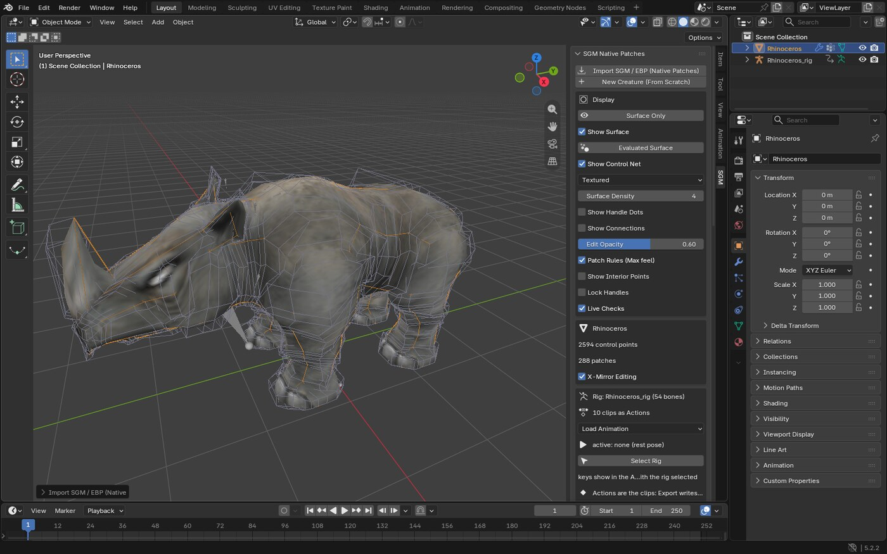

# IC Blender

*Impossible Creatures* is a 2003 real-time strategy game by Relic Entertainment in which players combine two animals
into new units. IC Blender is a Blender add-on for modding it: open the game's models and maps in Blender, edit them,
and export them back in the game's own formats.

**Alpha release: expect bugs.** This is a fan project, not affiliated with the game's owners.

## Features

| Area | What you can do |
|---|---|
| **Creatures** | Reshape the surface, add or remove pieces of it, edit the skeleton, textures and animations, preview a creature combined with another, and check it for problems before export |
| **New creatures** | Start from a template, convert a Blender mesh, reshape a creature to match your own mesh, or sculpt (the model only; see [Known limitations](#known-limitations)) |
| **Buildings, characters and props** | Edit meshes and animations, change the name, category, size and sounds, and export a folder you can copy into the game |
| **Maps** | Create or open maps, edit terrain, water, textures, objects, settings, triggers, dialogue and cut-scenes, and play cut-scenes back |

## Requirements

* Blender 5.3 or newer
* Your own copy of Impossible Creatures (tested with the Steam release)
* Linux. Windows and macOS are untested.

## Install

1. Download `ic_blender-<version>.zip` from the
   [latest release](https://github.com/akipina/ic_blender/releases/latest) (not "Source code").
2. In Blender, open **Edit > Preferences > Get Extensions**, choose **Install from Disk...** from the menu at the top
   right, and select the zip.
3. If the game is not in the default Steam folder, set **Game folder** in the add-on's preferences.
4. In the 3D Viewport, press **N** and open the **IC** tab.

## Quick start

A `.sgm` file is a model. A `.ebp` file is a blueprint: an object's settings in the game.

**Edit a creature**

1. To get the game's creatures as files, press **Extract Stock Creatures** in the **Combine Preview** panel. The
   message shows where they were saved.
2. Choose **File > Import > Impossible Creatures Model (.sgm / .ebp)**.
3. Press **Tab** and drag control points to reshape the surface.
4. In the **IC** tab, press **Validate (will it load?)**, then **Export Model**.

**Edit a building, character or prop**

1. Choose **File > New > Impossible Creatures Project...**, then pick a type, an existing game model to start from and an
   empty folder.
2. Edit the mesh with Blender's tools.
3. In the **Blueprint** panel, press **Load Blueprint**, change the settings and press **Export Entity Folder...**.

**Edit a map**

1. Choose **File > Import > Impossible Creatures Map from the Game...**.
2. Edit it with the tools in the **Map** panel.
3. Press **Save ready-to-drop folder...** to get a folder you can copy into the game.

The [user guide](docs/guide/index.html) covers each feature with screenshots. To read it, download this repository and
open the file in a browser.

## Using your files in the game

Use a separate copy of the game, because Steam can overwrite files in its own folder. Copy the exported `Data` folder
into the copy's main folder. The game then uses your files instead of the originals; delete them to undo. To replace an
existing object, export it with the same folder and file name. If something does not appear, look in `warnings.log` in
the game folder.

## Known limitations

* **Creatures:** only the model (`.sgm`) is exported. A new creature also needs other files (`.ebp`, `.lua`, `.lsc`)
  and a mod package, which you have to make yourself. Materials and smoothing groups (which edges look sharp) cannot be
  edited.
* **Buildings, characters and props:** material and texture changes are not saved (export warns you), and the skeleton
  cannot be changed. You cannot add mesh parts, or edit attachment points or damaged appearances.
* **Maps:** there is no script editor, and a map's size cannot be changed. The preview does not show ground lighting,
  shadows or moving water.
* **3D view:** models and maps appear mirrored compared with the game, so new shapes and text come out reversed in the
  game.

## More

* [Architecture](docs/ARCHITECTURE.md): how the code is organised
* [Issues](https://github.com/akipina/ic_blender/issues): include your operating system, Blender and add-on versions,
  the steps you took and the exact error message

## Licence

GNU General Public License v3 or later (see `LICENSE`). The bundled `construct` and `lupa` libraries are MIT licensed.
