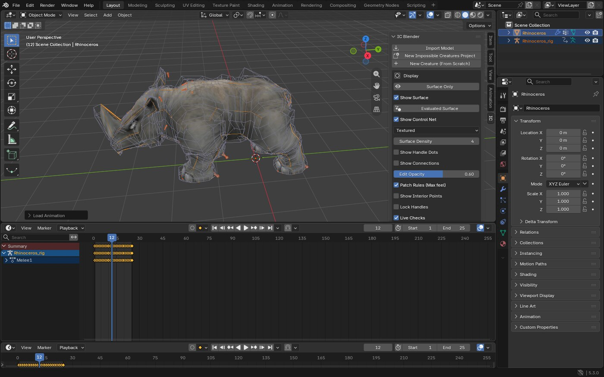
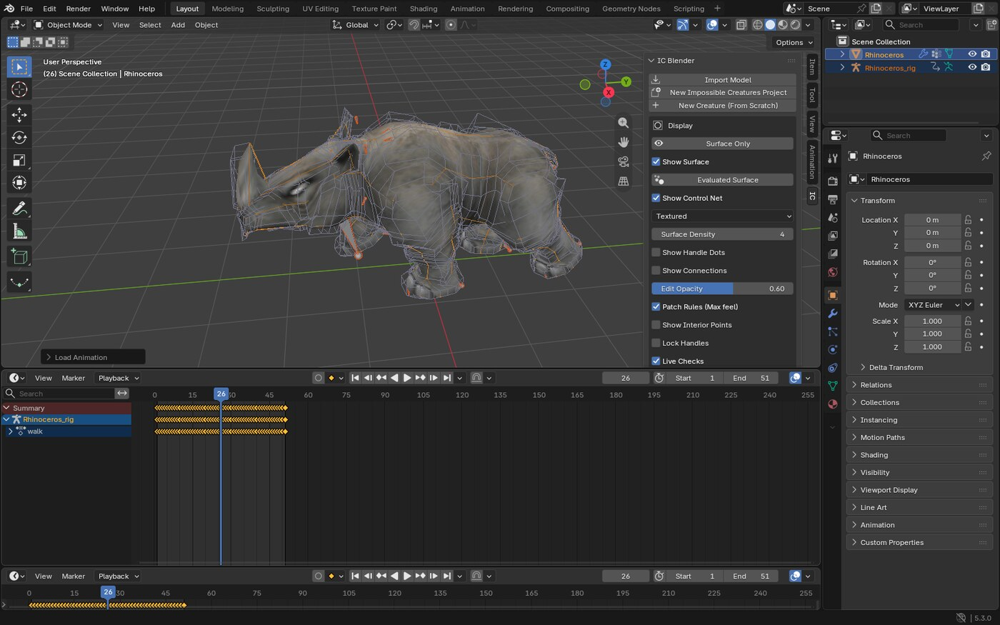
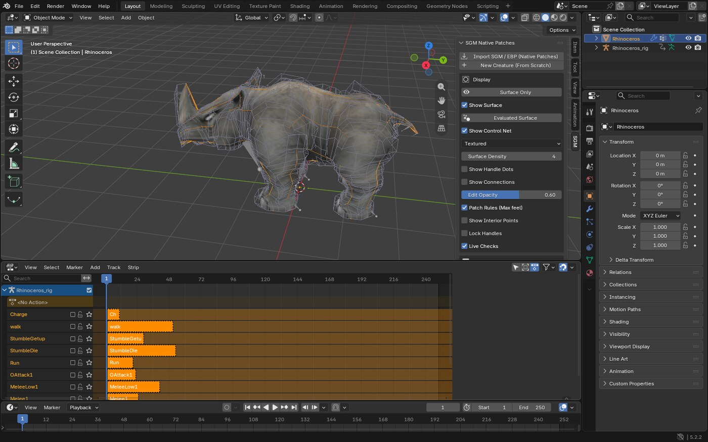
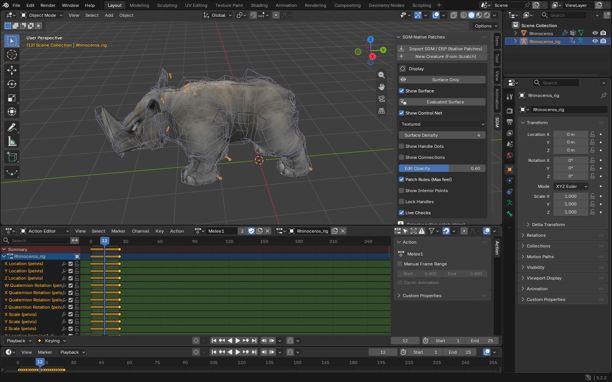
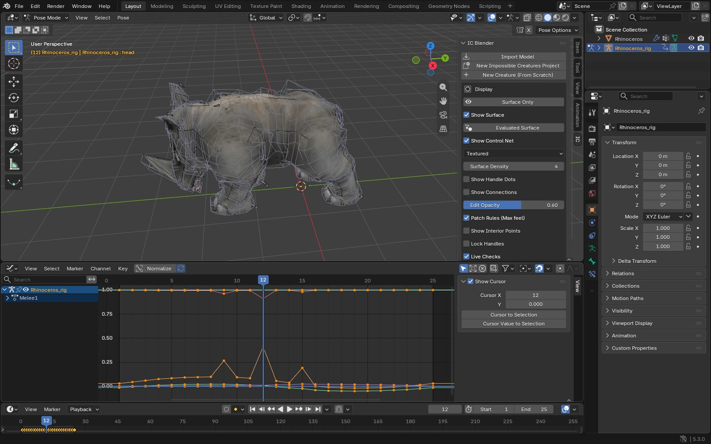

[Contents](README.md) · Previous: [Gameplay numbers](numbers.md) · Next: [Structures and props](structures.md)

# Animations and motions

This chapter is about how a creature, a worker or a building moves. It covers playing and changing the animations it has, making a new one, telling the game when to play it, getting the walking speed right, and borrowing animations from another model.

## Two words: clip and motion

A **clip** is one animation, for example *Idle1*, *walk* or *Melee1*. In Blender each clip is an **Action** on the rig.

A **motion** is a rule in the blueprint that says when a clip plays. The blueprint is the file that tells the game how the model behaves: its animations, sounds, effects and numbers. A clip plays in the game only when a motion names it. The game makes the motions for the usual clip names by itself, when the model loads, and only where the blueprint does not have a motion of that name. The names it makes motions for are:

- for a creature or a worker: **Idle1** (or **Idle**), **OAttack1**, **Walk**, **Run**, **Swim**, **Fly**, **Soar**, **Melee1**, **Melee2**, **MeleeLow1**, **StumbleGetup**, **StumbleDie**;
- for a structure: `build_01`, `build_02` and so on, `addon_x_01` and so on, `damage_01` and so on.

The game finds clips by name and ignores capital letters. `Idle1.max` is the same as `Idle1`. A clip with any other name never plays until you give it a motion. The add-on warns you about such a clip, and, for a near miss (`Attack1`, `Melee 1`, `Walk.001`), names the clip to rename it to.

## Play a clip

1. Select the creature (or the model). In the **IC Model** tab, in the rig box of the **IC Blender** panel, open **Load Animation** and choose a clip. The frame range and rate follow the clip.
2. Press <kbd>Space</kbd> to play, or drag the playhead in the timeline.
3. Choose another clip any time, there or in the Action Editor with the rig selected.

Fig. 1 · Melee1 at frame 12.

Fig. 2 · walk at frame 26.

If the rig box shows a button **Clips to Actions** instead of “N clips as Actions”, the model was opened without its clips as Actions. Press **Clips to Actions**. The line “active: none (rest pose)” means no clip is chosen yet, and the rig shows its resting pose.

Fig. 3 · Each clip is an Action on the rig, and the NLA editor (Blender's editor for layering animations) lists one muted track per clip. You do not need to use it.

## Change a clip

The Actions belong to the rig, so select it first.

1. Press **Select Rig**. Select the creature again when you want to edit its shape.
2. Open a **Dope Sheet** in **Action Editor** mode, or the **Graph Editor**.
3. Enter Pose Mode (<kbd>Ctrl</kbd>+<kbd>Tab</kbd>), go to a frame, pose a bone and key it with <kbd>I</kbd>. Auto Keying works too.

Fig. 4 · Each clip frame has a key on every bone.

Fig. 5 · The head is re-keyed at frames 9, 12 and 15.

Only clips whose keys or names you change are written again. The others come out as they were. If a clip you changed is a game name (Walk, Melee1 ...), the game plays your version. Nothing else needs doing.

## Make a new clip and make it play

Say you want a slow walk for when the creature is hurt. You need a clip, and then a motion that plays it.

1. **Make the clip.** Choose a clip to start from with **Load Animation** (for example *walk*). Open the **IC Game** tab and the **Motions** panel (it starts closed). Press **New Clip**, type a name (1 to 32 letters, for example `slow_walk`) and press **OK**. You should see a message “Made the clip 'slow_walk' (a copy of 'walk') and set it as the rig's active Action”. The clip belongs to the rig and is kept.
2. **Change its keys** in the Action Editor, as above. Keep the first and last pose the same so that it loops.
3. **Load the motions.** In the **Motions** panel press **Load Motions**. You should see a list of the blueprint's motions, with the motions each one starts indented below it. (If the panel says the model has no motion list at all, press **Make the Motion List**. It builds the standard motions from your clips.)
4. **Add a motion that plays the new clip.** Click the *Walk* motion in the list. Press **Add Copy**. In the window, set **Clip** to `slow_walk` and give it a **Name**. Leave **Start it wherever the original starts** ticked. Press **OK**.
5. **Give it its own range.** This step is the one people forget. The copy starts with the original's range, and where two motions start together, the one listed first covers the other. So a copy listed after the original is never seen until its range is different. (The window for **Add Copy** also has a box **List it before the original**. Tick it and the copy covers the original instead.) Under **Plays only while**, set **Variable** to `Velocity` (how fast the unit is moving, in game units per second; the game moves it by itself), and fill in **Above** and **Up to**: the lowest and highest speed at which this motion plays (-1 means no limit). Then click the original *Walk* motion and change its range so the two take turns and do not overlap.
6. **Set the speed.** Under **Speed**, **Speed follows** is the variable (`Velocity`) and **Clip made for** is the value at which the clip plays at its own pace. At twice that value it plays twice as fast. See “Walk and run speeds” below to get this number.
7. **Look at the box Check what you changed.** It lists what the game would do differently from what you most likely want: a motion that plays a clip the rig does not have, two motions that start together, a gap in speeds where nothing plays, a loop. It shows only what your changes brought, not what the original blueprint already had.
8. **Export** with **Export Creature for the Game** (or **Export Entity Folder** for a worker, a structure or a prop). The export tells you about any new clip that no motion plays.

## Walk and run speeds

A walk cycle has to be told how fast the creature was walking when it was made, or the feet slide on the ground.

1. In the **Motions** panel find the box **Walk and run speeds** and press **Measure Walk and Run Speeds**.
2. For each walking or running clip (a motion whose speed follows Velocity) you see a line like “walk: 3.20 (now 3.00, from the feet on the ground)”. A clip with no foot on the ground says “no answer”.
3. Press **Use** next to a line to put the measured number into **Clip made for**.

This is a good first guess. Look at the feet in the game and adjust. Motions that follow something else (an attack's time) are not measured and are never changed by it.

## Borrow clips from another model

You can copy the animations of another model onto your rig as new clips.

1. In the **Motions** panel press **Borrow Clips...**. (The panel needs a model with a skeleton.)
2. **Borrow from**: choose a model of the game, or set **Or a file** to a model on disk. A creature borrows from other creatures. A worker, a character or a structure borrows from other models of those kinds.
3. **Only these clips**: names separated by commas. Empty copies every clip you do not have yet. A clip you already have is skipped.
4. **New name**: works only together with **Only these clips**. Type exactly one clip name there, and give it a name your rig does not have yet. This lets you borrow the other model's Walk next to your own Walk. (Otherwise the message says “A new name works for one clip: name that clip under 'Only these clips'”.)
5. Press **OK**.

Bones are matched by name. A bone the other model has no bone for stays in its resting pose. Move distances are scaled to the size of your bones. The message says how many bones matched. If only a few do, the clips will hardly move, and the add-on warns you. A borrowed clip with a name the game knows (Idle1, Run ...) gets its motion from the game, only where your blueprint has no motion of that name. A borrowed clip with any other name needs a motion: use **Add Copy** as above.

## Renaming, deleting and exporting clips

- **Rename** the Action, not the NLA track or strip, to rename the clip. The motions that played it follow.
- **Delete** a clip in the Outliner: *Blender File* > Actions > right-click > Delete. Unlinking the Action or deleting its NLA track does *not* drop an imported clip.
- A clip made with **New Clip** or **Borrow Clips...** is kept. Any other new Action is exported only while it is the rig's active Action or sits on one of its NLA tracks.
- The scene's **Frame Rate** (Output Properties) is the rate of a new clip. **Load Animation** sets it to the loaded clip's rate. Check that it is 30 before you export a clip you keyed yourself.

## Reference

You do not need this part for the walk-through above. Come back to it when you want to know what a box does.

### The Motions box in full

- **Name** and **the clip it plays**: the magnifier lists the rig's clips, the play button shows the clip on the rig so you can watch it in Blender.
- **Loop**: whether the clip repeats.
- **Speed**: **Speed follows**, **Clip made for**, **Play speed** and an invert button.
- **Plays only while**: **Variable**, **Above** and **Up to**. This is how Idle, Walk and Run take turns.
- **More**: fade in and out, strength, how much of the clips below shows through, start delay, pause between loops.
- **Add Copy**: a new motion like the selected one.
- **Delete**: removes the selected motion (the motions it started stay) and fixes the numbers of the others for you. If the game makes a motion like it by itself when the model loads, the message says it comes back. Change the motion instead of deleting it, or give the clip another name.
- The play button next to the list (**Start With This**): the motion the model starts with.

The changes are written when you export. Only the motions you changed are written again. If you change nothing, the blueprint is the original byte for byte, and the export says nothing about its motions. If you rename a clip in Blender, the motions that played it follow the new name. If the export says the blueprint's motions are not the ones the box loaded, the blueprint is another one now and your motion changes were not written. Press **Load Motions** to read it again (this drops your motion changes) and make them again.

> [!NOTE]
> What starts a motion is a range on a variable the game moves. The game's engine moves `Velocity` (how fast the unit goes). The game's rules move `Build` and `Damage` (structures), `AttackTime` (attacks) and a few others, and start some motions by name. A motion that no range reaches, and that no playing motion lists as a child, does not start. A variable name that is not one of the game's own cannot be checked: a name you type is trusted.

### Rules the game imposes

- A bone with no keys in a clip stays at rest under its parent.
- One Action is one clip. Mixing in the NLA editor is not exported. Mute the NLA tracks you do not want counted to silence the warning.
- Keys on a missing bone are left out, with a warning. For a creature, rename bones with **Boner > Bones > Rename Bone**, which updates the Actions. For a building, a worker or a prop there is no Boner panel: rename the bone in the Outliner (or press <kbd>F2</kbd> in Edit Mode), as in [Structures and props](structures.md), “The skeleton”.
- Actions left over from an earlier rig are ignored, with a warning.
- Each clip stores two boxes (one for the whole clip, one for its last frame) that the game uses to decide when a unit is on screen. When a reshaped body changes the creature's size, the export recalculates the boxes of the clips it keeps as they are. The keys are not touched.

> [!IMPORTANT]
> **Limits**
>
> A motion can be added as a copy under the same parents as its original, or under none. You cannot move a motion under another one in the box. Old blueprints of version 1 or 2 use only Velocity as the speed and the condition variable.

---

[Contents](README.md) · Previous: [Gameplay numbers](numbers.md) · Next: [Structures and props](structures.md)
