[Contents](README.md) · Previous: [Re-texturing and texturing from scratch](texture.md) · Next: [The Blueprint panel](blueprint.md)

# Bones, limbs and connections (Boner)

The game loads a creature when its patches are watertight and rigged. To *combine* in the game, its limbs, connections and skeleton must also follow the rules of the game's combiner (the creature creator). Edit them in the **IC Model** tab under **Boner**: **Bones | Limbs | Connections**. Every edit can be undone, and a refused edit changes nothing.

## The model in one minute

- **Limbs** are named groups of patches, each with a class and a bone list. A class combines Side, Position, Plane and Type; **Non-Swappable** parts stay with their torso.
- A limb other than the Torso is a root bone and its descendants. The Torso owns every other bone.
- **Stub limbs** have one bone and no patches, so the creature can still receive wings or arms. The game's check requires the leg, arm and wing classes.
- **Connections** are the sockets where limbs are grafted. Each has a Parent class (usually Torso), a Child class, a host bone in the parent limb, and a ring of corners (6 for head or tail, otherwise 4).
- The game finds bones by standard names (`pelvis`, `spine1`, `neck1`, `head`, `tail1`, `front_leg1_l` and so on).
- The combiner refuses a creature with a limb class that has no connection, a Left limb without its Right mirror, or a limb with no bones.

## Setting up

1. Use **IC Model** tab > **Import Model** on `rhinoceros.sgm` and widen the sidebar.
2. In **Display**, tick **Show Connections**.
3. Open **Boner** and choose **Limbs**. With *Follow Shading* on, the shading switches to **By Limb**.

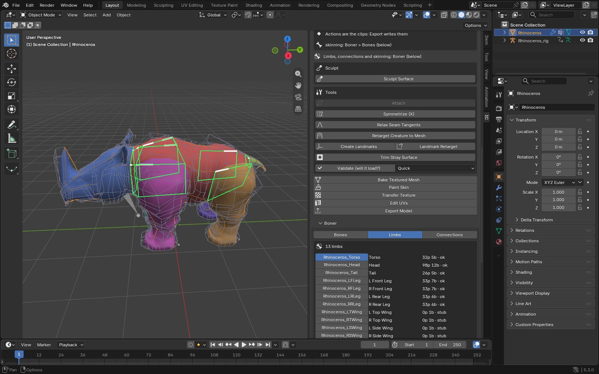

Fig. 101 · Limbs are shaded, and rings show where they graft.

## Boner > Limbs

Each row shows the limb's name, class, patches, bones and status; problems are red. Click a name to select it.

1. **Rename**: a unique name of up to 63 ASCII characters.
2. **Class boxes**: ticking one clears the others in its group. Non-Swappable stands alone.
3. **Select Bones** selects the limb's bones on the rig (visible in Pose or Edit Mode). The **Bone** field shows which limb a bone is in.
4. **Set Root Bone** gives the limb a bone and its children. It is for rigs with their own root bones; stock creatures refuse other roots.
5. **Add Active Bone** moves the chosen bone into this limb. **Remove Active Bone** leaves it in no limb. You are warned if this strands points.

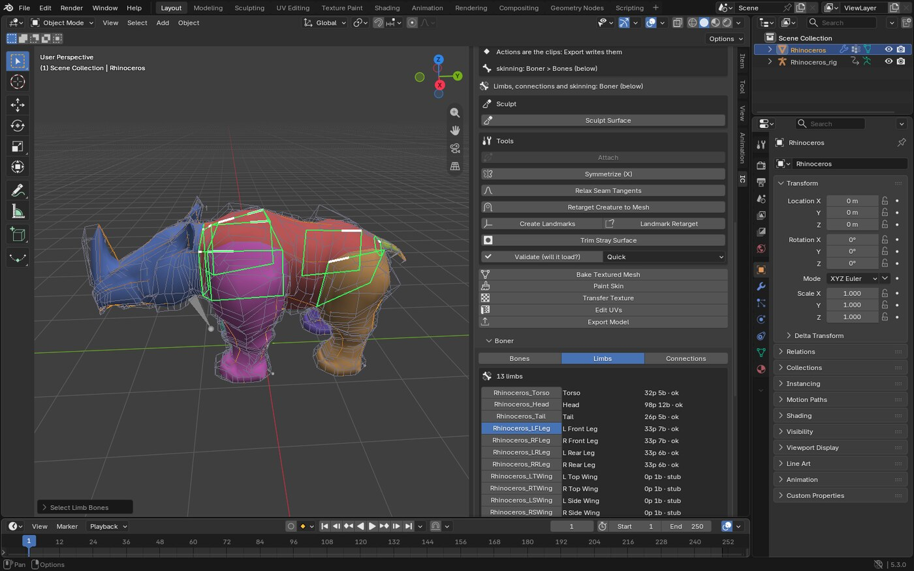

Fig. 102 · The selected limb shows its class and bones.

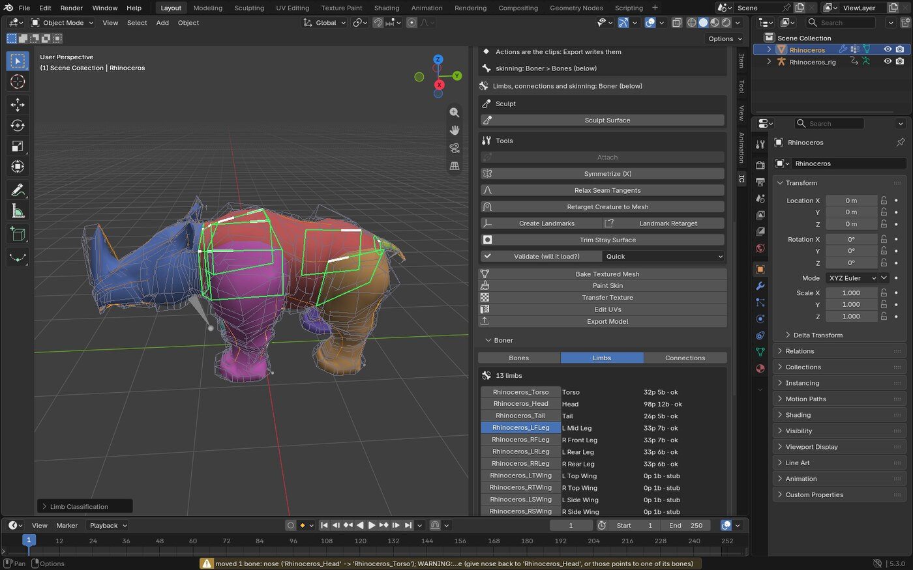

Fig. 103 · Changing a class also updates its connection.

6. **Add Standard** adds a missing standard limb as a stub. Its root bone must exist. For front legs, rear legs, wings and arms, use **Add Stub Socket**, which can create the bone.
7. **Delete** asks where the patches go and leaves the bones in no limb. You can't delete or untick a class that a connection still needs, or untick the Torso.
8. In Edit Mode, **Select Limb** and **Assign Selected to Limb** select and move patches.

## Boner > Connections

Each row shows Parent > Child class, corners (picked / wanted), host bone and status. Click a row to highlight its ring.

1. **Rename** or **Delete**. A limb left without a connection is refused by the combiner.
2. **Parent** / **Child** chooses which class the boxes edit. A Child class that another connection already has shows as *duplicate*.
3. **Host bone**: choose one and press **Set**, or press **Default**. It must belong to the parent limb.
4. **Create for Limb** makes a missing connection. Then pick its ring.
5. **Pick Ring** (Edit Mode): click the corners along patch sides; the ring closes by itself. Backspace steps back, Esc cancels. Or Shift+click the corners in order and press **From Selection**.
6. **Optimise Start** / **All Rings**: see below.

## Optimise Ring Start: where the weld begins

The combiner welds two rings corner by corner from each ring's first corner. A wrong start twists the seam.

1. **Optimise Start** tries every start for the active ring and keeps the one that welds best with stock creatures.
2. The report shows the improvement and how far the worst corner moves.
3. An already good ring is refused. **All Rings** does the whole creature in one undo step.
4. It never reverses a ring, but reports when a reversed one would weld better.

Check the ring's start: a wrong start only shows in combinations.

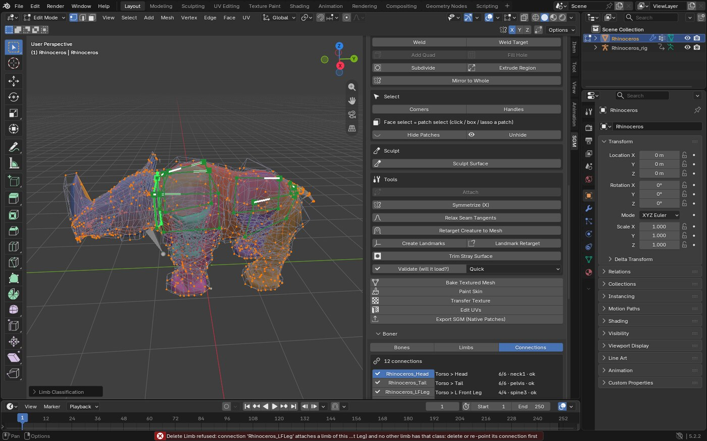

Fig. 104 · The head connection and its ring are selected.

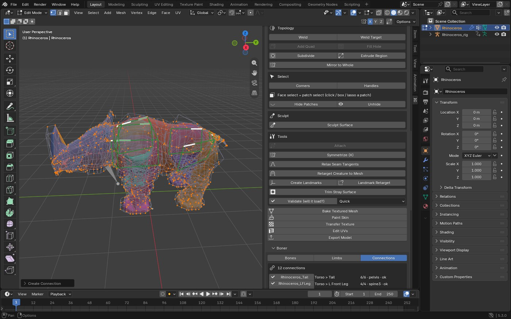

Fig. 105 · A new connection needs a ring.

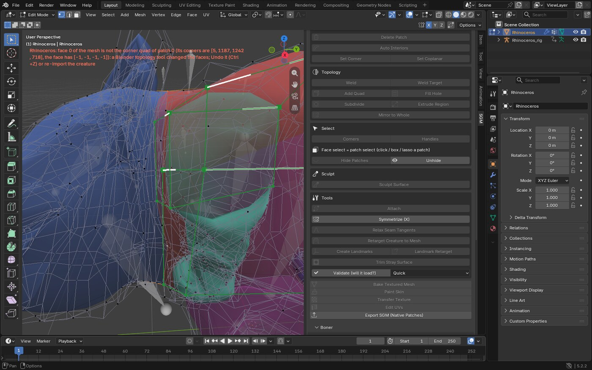

Fig. 106 · From Selection orders the ring for you.

## Add Stub Socket: a class the creature does not model

Without arm stubs, for example, a creature can't take arms, and the game's check warns *Required limb class not found*. **Add Stub Socket** adds the stub limb and its connection. Its menu lists only the classes that no limb and no connection of the creature has. The stock rhinoceros already has its arm stubs, so to follow this example on it, first delete the connections of its two arm stubs (classes `LFArm` and `RFArm`, in the **Connections** tab) and then those two limbs (**Limbs** tab). The pictures show a rhinoceros stripped that way.

1. In Edit Mode select the **4 corners of one Torso patch** (such as a shoulder for arms, or the back for wings).
2. Choose a missing class, for example **Add Stub Socket > LFArm**. The bone, ring and host bone are set up for you.
3. Add the other side too.

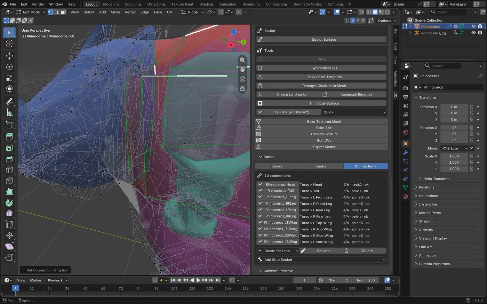

Fig. 107 · Select one torso patch.

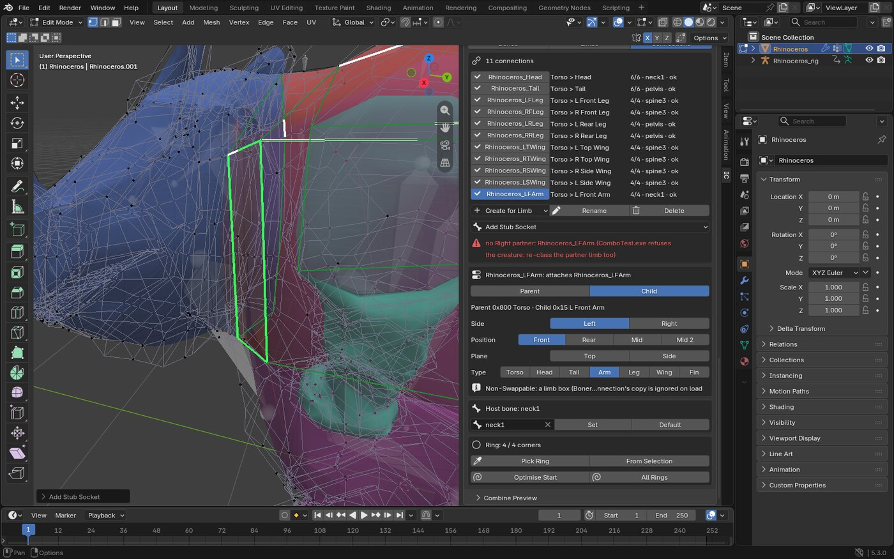

Fig. 108 · The new socket sits on that patch.

## Boner > Bones: renaming, adding, deleting and re-parenting bones

This tab also holds the skinning tools (see [Skinning and re-skinning](skin.md)).

1. **Rename Bone** (pencil next to **Bone**, or Blender's F2). Use a unique name of up to 63 ASCII characters; references and Actions follow. Renaming a bone the game looks up is allowed but warned. To reuse another bone's old name, export and re-import first.

2. **Add Bone under Active**: choose the parent in **Bone**, then give a name, offset and length. Skin points to it with **Assign Selected**.
3. **Adopt Added Bones** (import icon) takes in bones made with Blender's tools. Chains and copied bones with children need it; a single new leaf is exported without it.

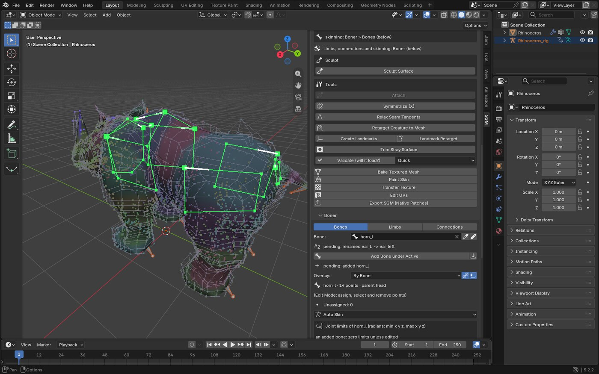

Fig. 109 · A new bone with points skinned to it.

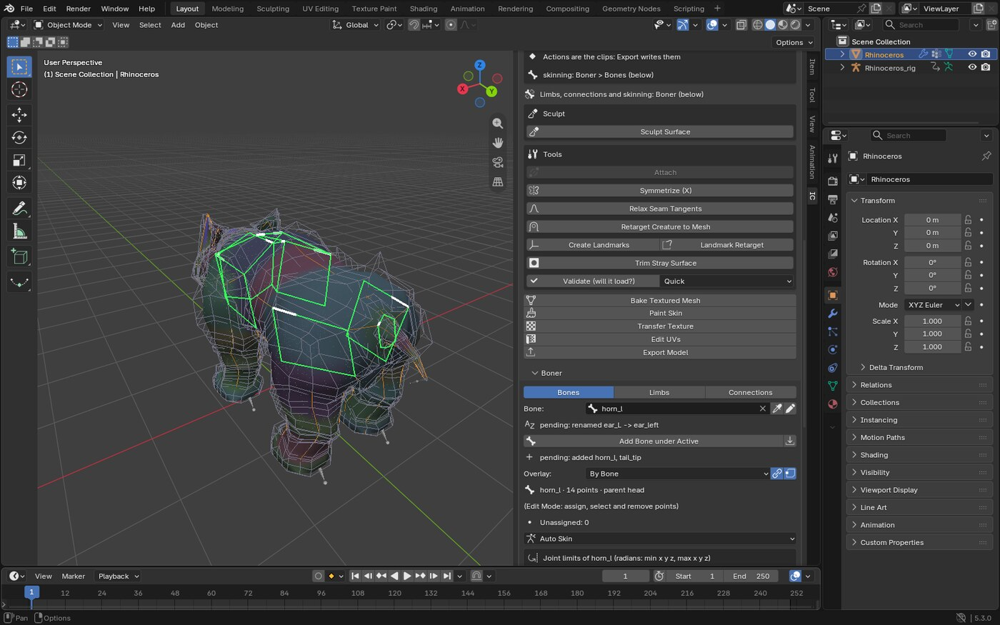

Fig. 110 · A Blender-made bone waiting to be adopted.

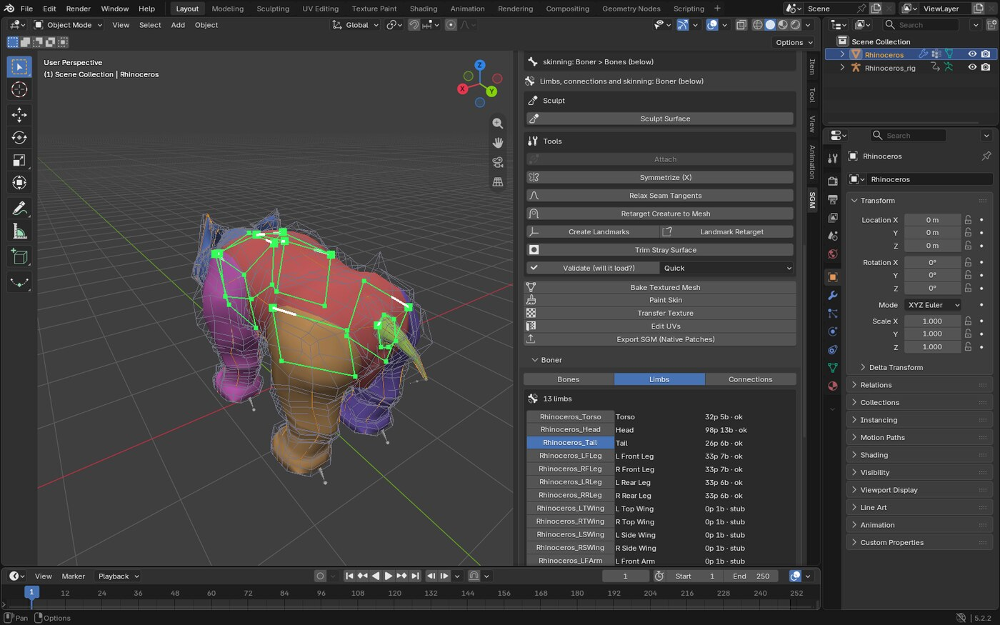

Fig. 111 · The adopted bone is in its parent's limb.

An added bone always belongs to its parent's limb; re-parent it to move it.

## Deleting and re-parenting the creature's own bones

Use <kbd>X</kbd> and <kbd>Ctrl</kbd>+<kbd>P</kbd> in the rig's Edit Mode, or the Outliner.

- **Deleting** a bone gives its points and children to its parent, and removes it from limbs, IK chains and clips.
- **Re-parenting** keeps the bone's rest position and its animation.

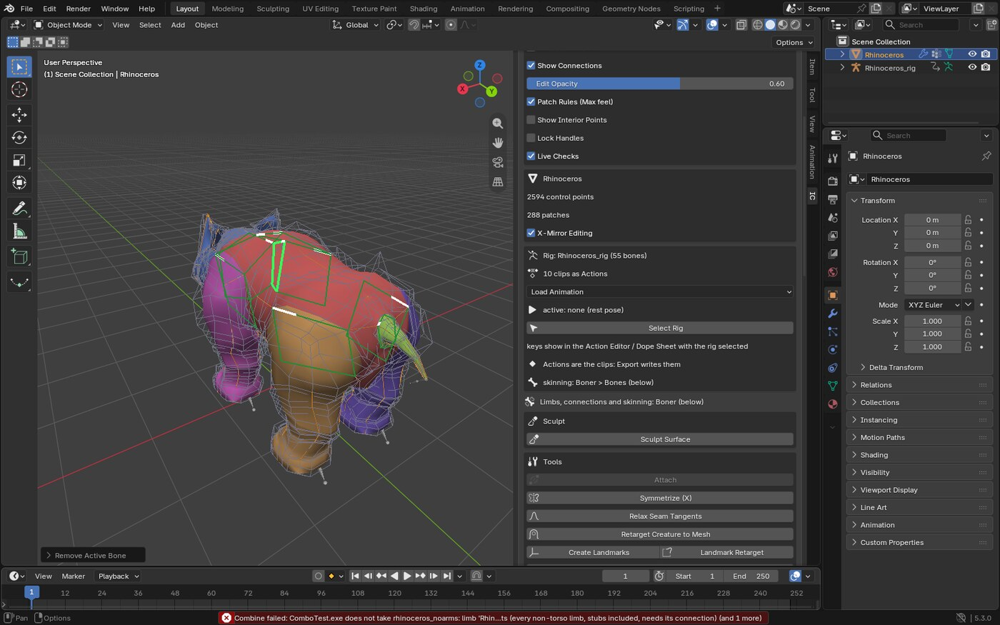

Fig. 112 · A deleted bone's points move to its parent.

You can't delete the root, bones the game looks up by name, stub bones, host bones or a limb's only bone. You can't move the root, make a second root, put a bone under a stub, or split a limb other than the Torso.

## Joint limits

- **Joint limits**: each rig bone's `bz_joint_limits` property, in radians. **Reset to Stock** restores it.
- Joint limits may have no effect in the game. The creature's IK chains are kept as they are, and are not edited here.

## Validate, Combine Preview and the Quick combine tier

**Validate (will it load?)**, with **Combine Checks: Quick** (default), reports:

- problems that block loading;
- `STOCK`: things every base-game creature has but yours lacks;
- `WARN`: advice;
- `COMBINE`: trial combinations with stock creatures. A `COMBINE ERROR` means the combiner fails on your creature.

1. To try it, break a creature: tick Mid on LFLeg only, delete the LFArm connection, and remove `nose` from the Head.
2. Press **Validate (will it load?)** and read the lines in an **Info** editor.
3. Open **Combine Preview**, choose a stock animal as the other creature and press **Preview**. It stops at the first refusal. **Validate Combines** runs only the quick combine checks.

Change the class of left and right partners together, and keep the name of the `tail1` bone.

---

[Contents](README.md) · Previous: [Re-texturing and texturing from scratch](texture.md) · Next: [The Blueprint panel](blueprint.md)
