[Contents](README.md) · Previous: [Finding your way around a creature](tour.md) · Next: [Topology: making geometry, not just moving it](topology.md)

# Editing an existing animal

The fastest way to a new creature is to reshape a working one. This chapter uses the game's rhinoceros. Start it as a project (**File > New > Impossible Creatures Project...**, **Start from** **Rhinoceros (Base game)**; see [A new creature from a game animal](newcreature.md)). The object's vertices are the file's control points, and the export writes only what changed.

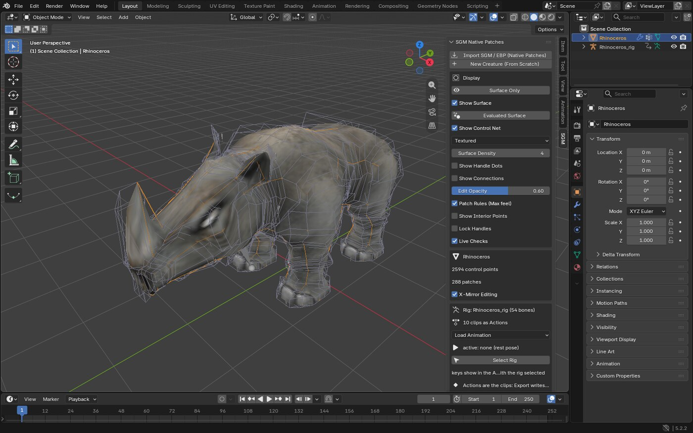

Fig. 16 · The rhinoceros after **Import Model**.

## Into Edit Mode: what the points are

1. Open the rhinoceros as a project (see above), or open a model file with **IC Model** tab > **Import Model** (**File > Import > Impossible Creatures Model (.sgm / .ebp)**).
2. Press <kbd>Tab</kbd>. Select points as usual: click, box (<kbd>B</kbd>), lasso, <kbd>A</kbd>.
3. Turn on **Show Handle Dots**: corners (on the surface) are gold, handles blue.
4. Each patch's four **interior points** are hidden and move automatically. **Show Interior Points** reveals them. Moving one makes its patch manual; **Auto Interiors** restores it.
5. In the **Select** box, **Corners** and **Handles** select one kind of point.
6. Press <kbd>3</kbd> to select whole patches (see [Topology](topology.md)).

## It edits like an Editable Patch

With **Patch Rules (Max feel)** on (default), editing works like a 3ds Max or gmax Editable Patch:

- A moved corner brings its handles. A handle moved alone stays where you put it.
- **Set Coplanar** keeps a corner's handles in one plane; **Set Corner** frees them.
- **Lock Handles** rotates a corner's other handles with the one you move.
- Turn Patch Rules off to place single points exactly.

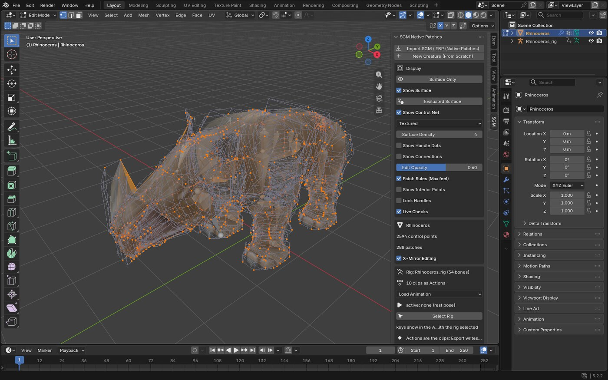

Fig. 17 · Edit Mode shows the **Modeling** and **Select** boxes.

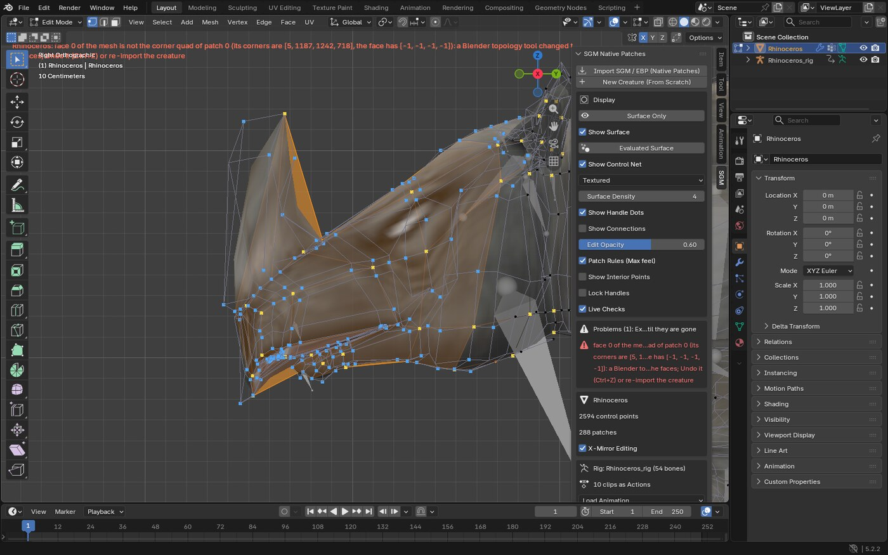

Fig. 18 · **Select > Corners** picks the points on the surface.

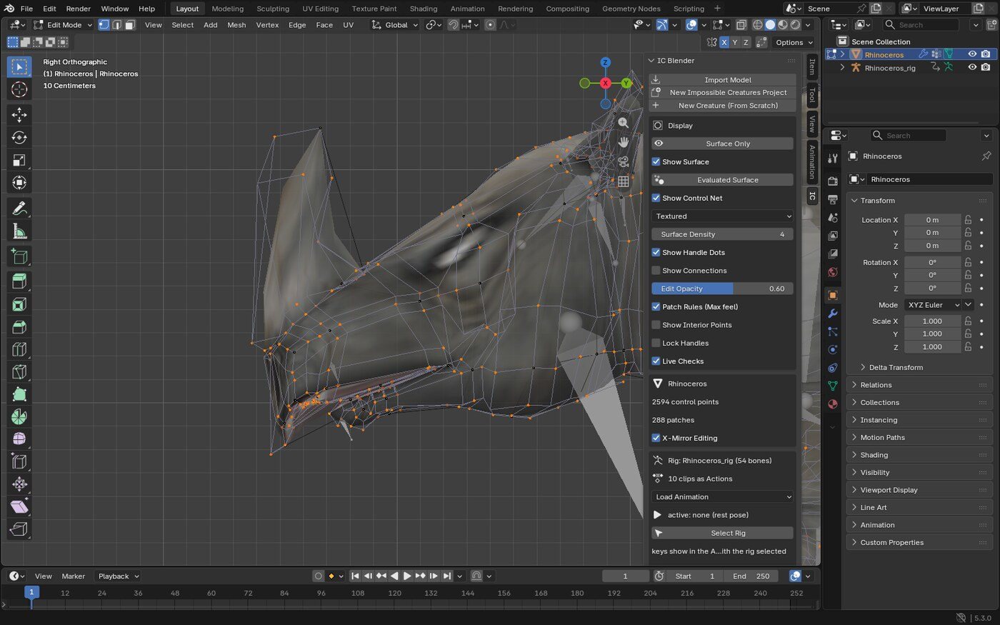

Fig. 19 · **Select > Handles** picks the points off the surface.

## Moving points: lengthen the horn

To move a whole feature, select its corners and the handles around them.

1. View from the right (<kbd>Numpad 3</kbd>) and box select the horn tip.
2. Press <kbd>G</kbd> and move. For an exact move, type <kbd>G</kbd> <kbd>Z</kbd> <kbd>0.45</kbd> <kbd>Enter</kbd>.
3. Press **Export Model** at any time. The report counts the re-encoded points, including those the patch rules moved.

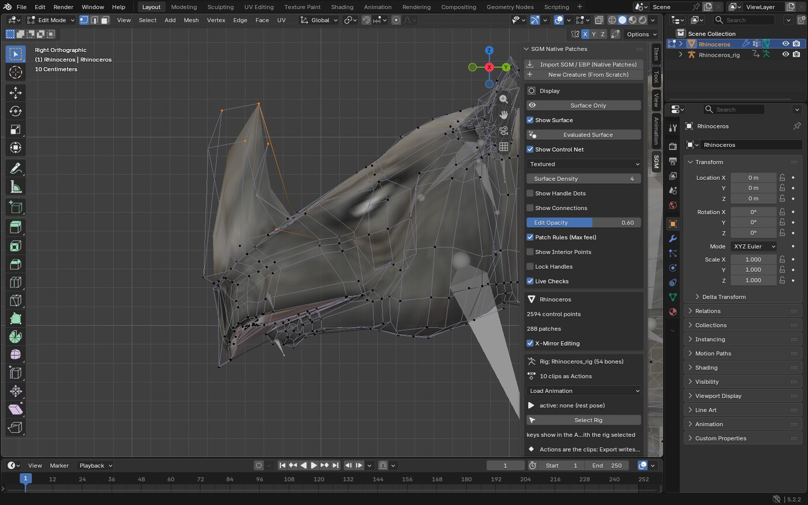

Fig. 20 · The horn tip selected.

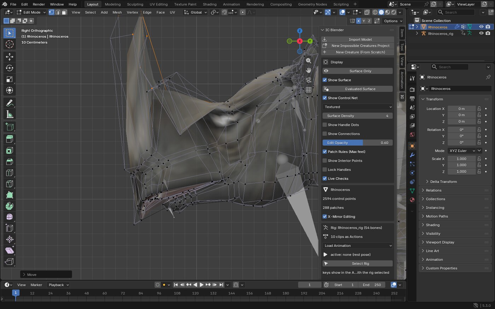

Fig. 21 · The surface follows the move.

## Undo, also across Tab

<kbd>Ctrl+Z</kbd> works in both modes and across the mode switch. <kbd>Ctrl+Shift+Z</kbd> redoes.

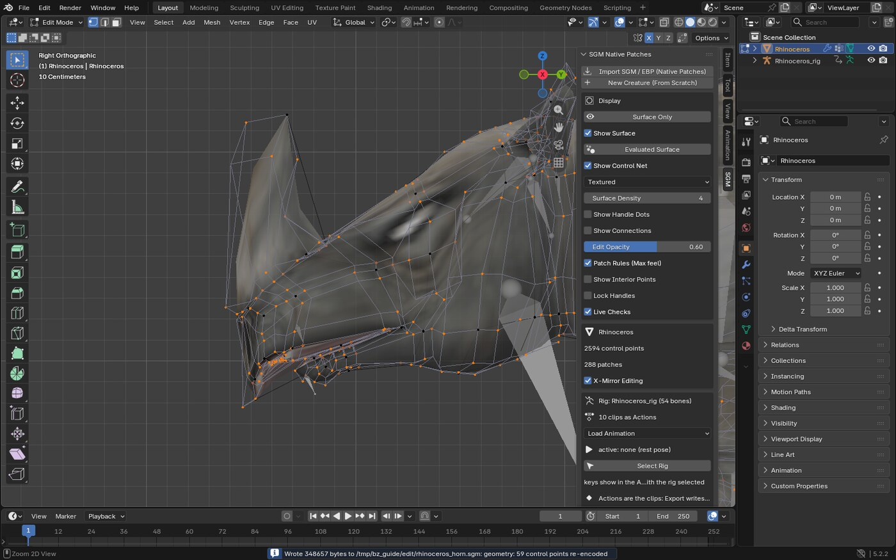

Fig. 22 · Undo restores the horn.

## Symmetry: Symmetrize (X) and X-Mirror

**Tools > Symmetrize (X)** averages each mirror pair into exact symmetry and puts centre points on X = 0.

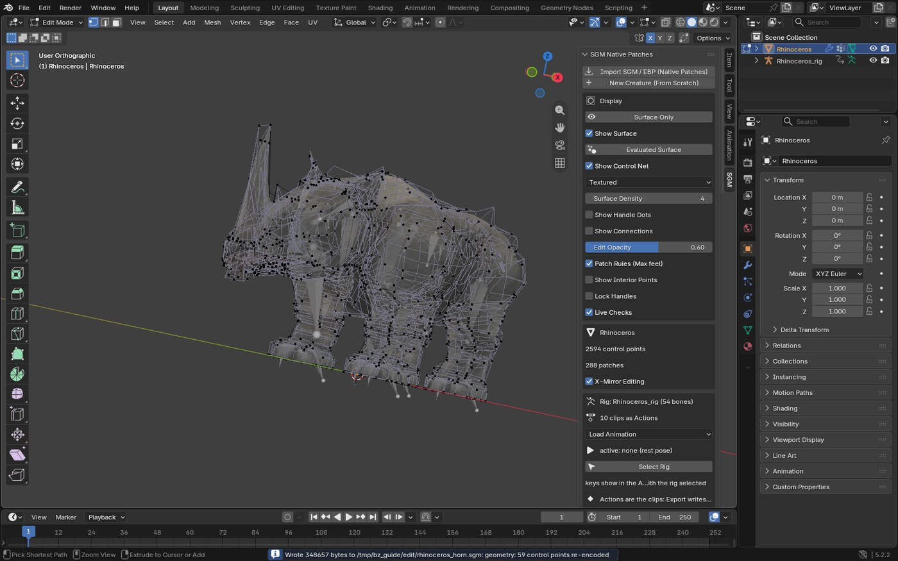

Fig. 23 · The result of **Symmetrize (X)**.

**X-Mirror Editing** is on from import but only finds exact mirror partners. Run Symmetrize first; asymmetric edits break the pairs again. The dependable way is to select both sides:

1. Select the points on one side, such as the left ear.
2. Use **Select > Select Mirror** (<kbd>Shift+Ctrl+M</kbd>) with *Extend* on.
3. Move both, for example <kbd>G</kbd> <kbd>Z</kbd> <kbd>0.3</kbd> <kbd>Enter</kbd>.

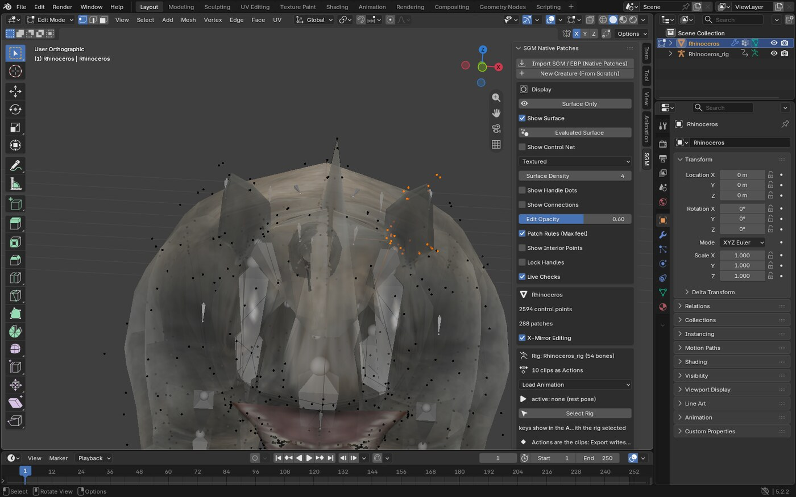

Fig. 24 · Only the left ear selected.

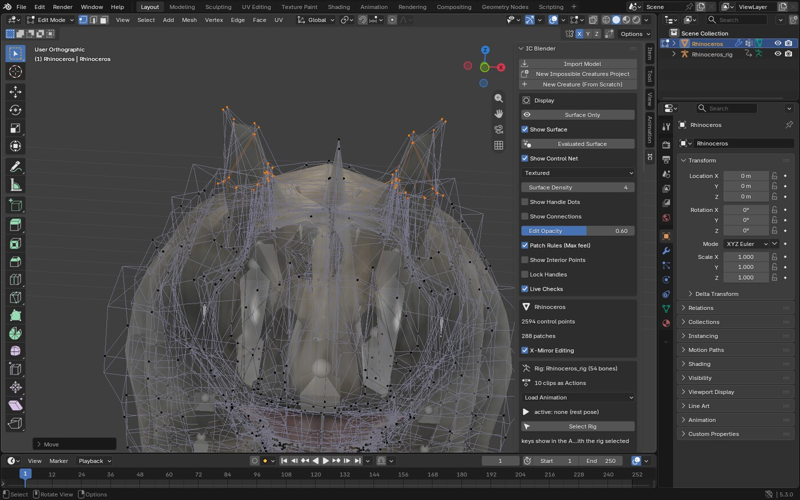

Fig. 25 · Both ears raised together.

## Proportional editing: raise the back

Select the top corner on the back, press <kbd>O</kbd>, then <kbd>G</kbd> <kbd>Z</kbd> <kbd>0.35</kbd> <kbd>Enter</kbd>. Scroll during the move to change the radius. Press <kbd>O</kbd> again before precise moves.

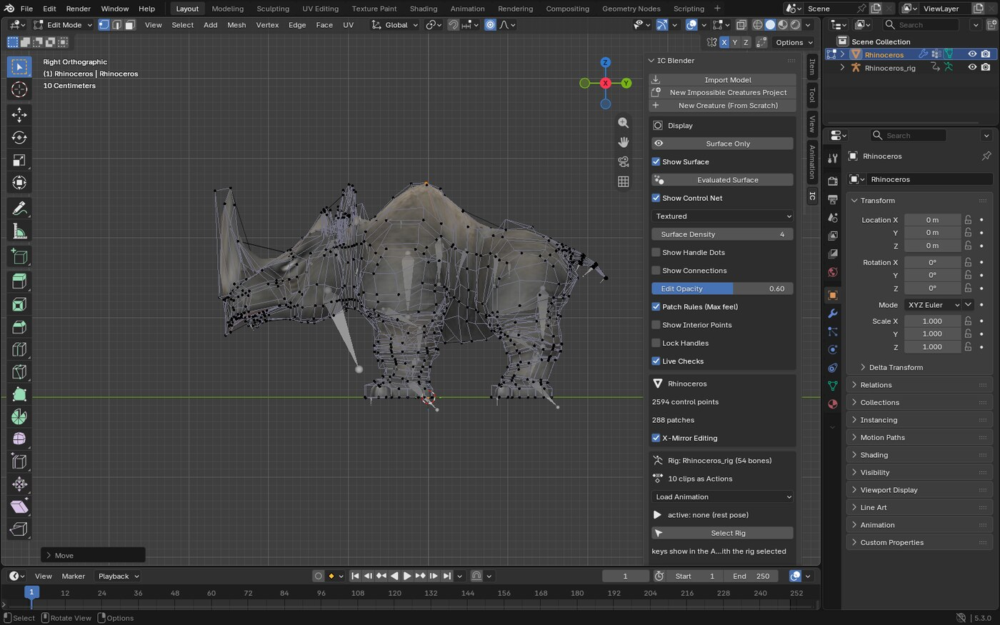

Fig. 26 · Proportional editing raises a smooth hump.

## Relax Seam Tangents

**Tools > Relax Seam Tangents** smooths the creases between patches without moving the seams. It treats all seams, or only a seam whose four points you select. Repeat for more effect.

## Extrude Patch: growing geometry

**Modeling > Extrude Patch** grows one patch from one *open* side (used by only one patch). Select that side's two corners, or all four corners of a patch with one open side. Stock creatures are closed, so delete a patch first. To grow patches on several open sides at once, use **Add Quad**; for that and more tools see [Topology](topology.md).

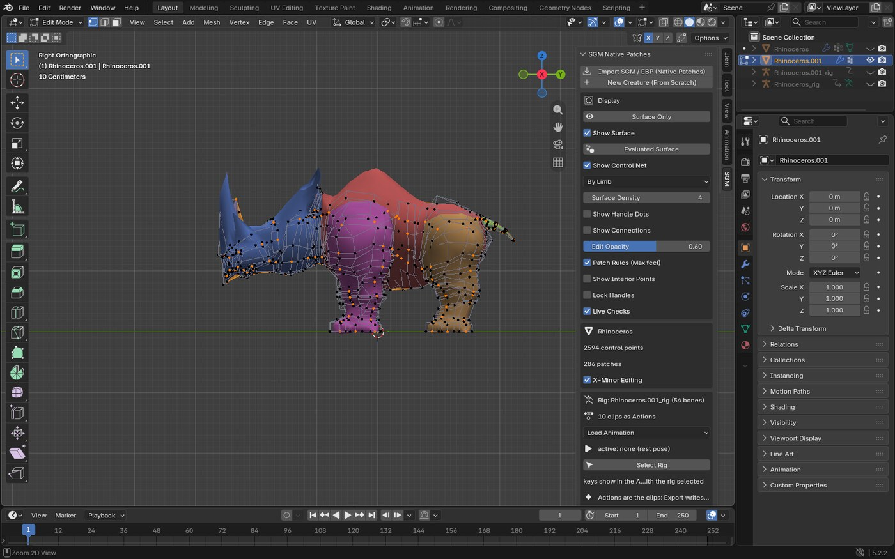

Fig. 27 · A copy with one patch missing on each flank.

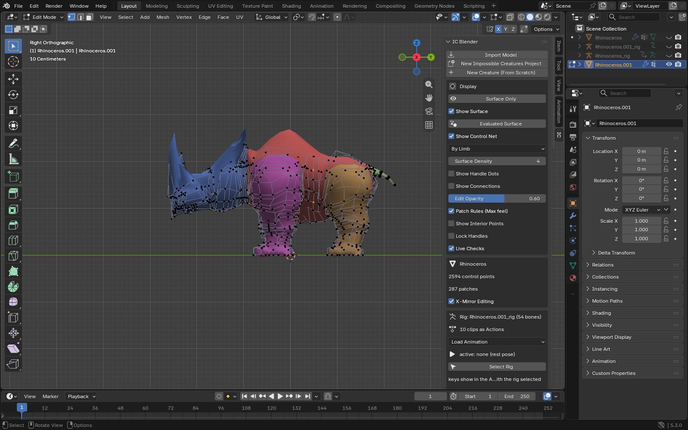

Fig. 28 · **Extrude Patch** grows a patch from the selected side.

A new patch takes its bone, limb, material and UVs from the patch it grew from.

## Loop Cut

In Edit Mode, in **Edge select**, click an edge that runs *along* a limb (from the body towards the tip), then press **Loop Cut** (**Topology** box). The cut goes round the limb through the middle of that edge, through every patch it meets, and splits each of them in one direction only. The surface does not change. It never crosses a connection ring: a cut that would is refused and the message names the ring. Then pick an edge that runs along the limb instead of one that goes around it. A whole patch selected (Face select) is refused: Loop Cut needs edges. **Subdivide** still splits whole patches both ways, and refuses where that would cross a ring.

## Validate: will it load?

**Tools > Validate (will it load?)** checks what Export would write. See the status bar and Info editor.

- **No prefix** (blocks loading): open or over-shared edges, more than 12,288 display vertices, patch points with no bone, or *EXPORT BLOCKED* (read the reason; undo any vertex Delete, Merge or Duplicate).
- **STOCK**: standard clips, bones, rings or IK chains are missing. It loads, but may behave differently.
- **WARN**: advice. *clip 'X' will never play* means no motion uses that clip's name (see [Animations](anim.md); the game ignores case and a trailing `.max`, so `Idle1.max` is simply `Idle1`), with a rename hint when the name is a near miss. The same line says when the game will not make a motion for a clip it would otherwise know: `Soar` without a `Fly` clip, a `build_NN` or `damage_NN` run with a gap, or a blueprint that already has a motion of that name playing another clip. *the blueprint wires a motion node to clip 'X', but this creature has no clip of that name* means a clip was renamed or deleted and its motion now plays nothing (the game's own animals have a few such motions too).
- **COMBINE**: results from **Combine Checks**, never blocking.

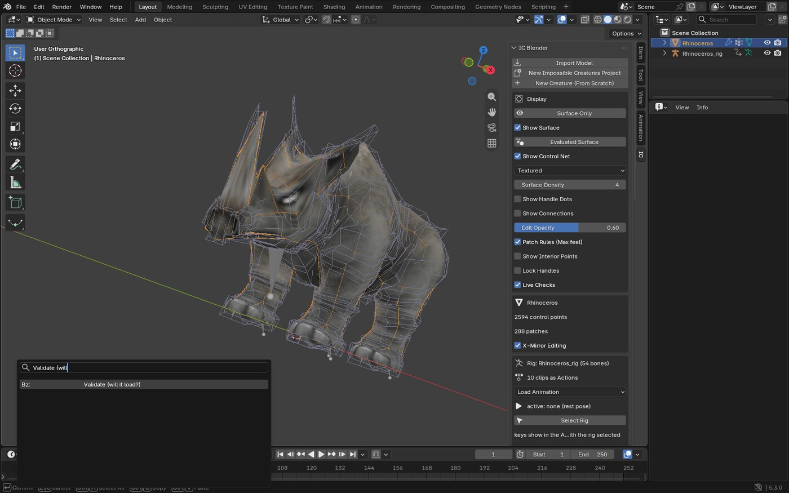

Fig. 29 · Operator search also finds Validate, with Developer Extras enabled.

## Export and the export summary

1. Press **Export Model** and save outside the stock folder. It will not write over an extracted stock creature unless you tick **Overwrite Extracted Stock File**.
2. Export runs the same checks as Validate (without the combine run). If any *block loading* it refuses, lists them and says how many warnings and stock-rulebook gaps there are. Fix them, or export again with **Export Anyway** ticked (it is off again for the next export).
3. Read the report. It names only what changed: geometry, rest pose, rings, textures or clips, and ends with the check counts. When the body's size changed, the kept clips get new bounds (keys untouched) and the report says so.

## Hard edges and materials

A **hard edge** is a crease: the shading breaks at a corner where two patches meet. A stock animal has some. The box **Hard Edges and Materials** (shown with a creature, in Edit Mode) has the tools.

- **Show Hard Edges** marks, as Blender's *Mark Sharp* edges, the sides where the creature already has a crease. You do not have to press it first. The creases the file already has are kept when you mark or clear another one.
- In Edit Mode, select patches or edges and press **Make Hard** or **Make Smooth** (or use Mark Sharp yourself). The export writes them as the creature's hard edges.
- A hard edge creases the shading at the corners where two patches meet. Between the corners the game keeps the shading smooth at its finer detail levels. The game does **not** copy a creature's hard edges into a combination of it, so a hard edge is how the creature itself looks. Check how combinations look in the game.
- **Show Material Slots** gives the mesh the creature's own materials as Blender material slots. Select patches and press **Set Material** (or assign a slot in Blender's Material tab). The export writes each patch's material. A slot number the creature does not have is refused.

> [!NOTE]
> Careful with the torso. When the game combines your creature, it repaints the material of the **first patch of the torso** with the blended skin. Check warns when most of the torso uses another material than its first patch, or when two torso materials look the same but have different names. Give the whole torso one material, or at least make its first patch the main one.

## Next: take it into the game

Export Model writes a model file only. To play the creature in the game, use **Export Creature for the Game** in the **Game** panel of the **IC Game** tab. The chapter [A new creature from a game animal](newcreature.md) goes through it, and [Check, export, install, remove and share](ship.md) explains every step.

Delete patches with the add-on's tools (**X > Patches**), not Blender's vertex or edge delete, merge or sort.

---

[Contents](README.md) · Previous: [Finding your way around a creature](tour.md) · Next: [Topology: making geometry, not just moving it](topology.md)
