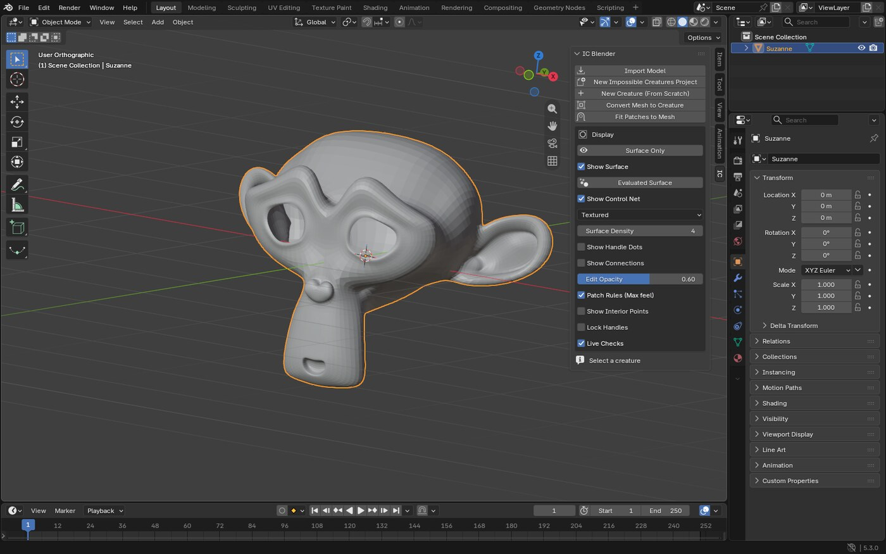
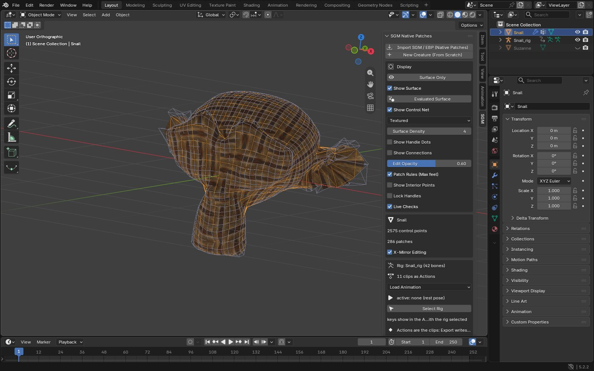
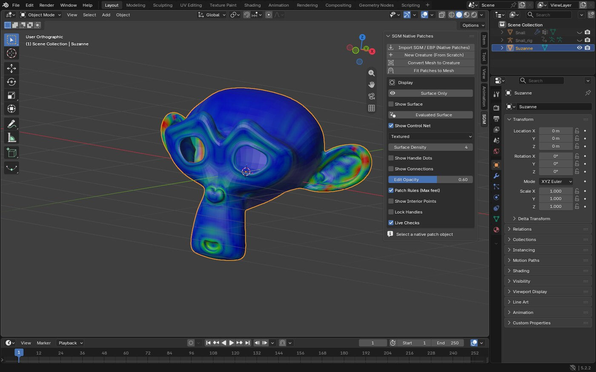
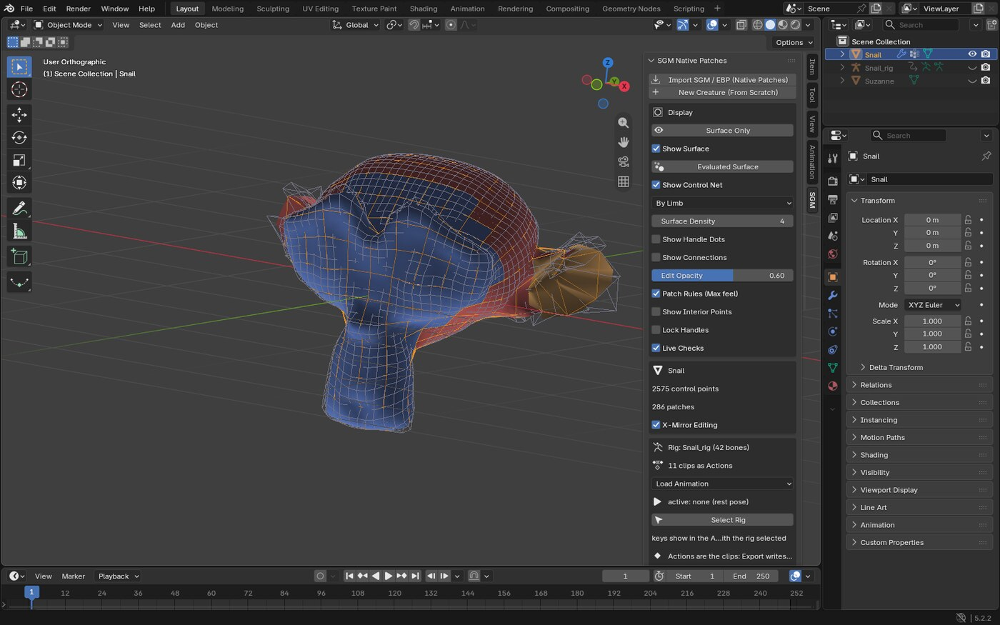

[Contents](README.md) · Previous: [Making an animal from scratch: a rhino](scratch.md) · Next: [Retargeting: an existing creature takes another shape](retarget.md)

# Fitting a mesh: an outside model becomes a creature

**Fit Patches to Mesh** turns an ordinary mesh (sculpt, scan, `.glb`, `.obj`) into a patch creature. It borrows a template creature's skeleton and materials, writes a `.sgm` and imports it. The example is Suzanne, without eyes and subdivided twice.

> [!IMPORTANT]
> **Limits**
>
> The result is **shape only**. It has the skeleton and the limbs of the template you chose and **no connection rings**, so the game cannot combine it with other animals, and **Export Creature for the Game** refuses it. For a creature that plays in the game, start from a game animal and use **Retarget Creature to Mesh** or **Landmark Retarget**. The chapter [A creature from your own mesh](mesh.md) compares the two routes.

Fig. 67 · The target mesh.

## What the fit will accept

- The body must be **one connected piece**. Open edges are fine with *QuadriFlow*, which closes them; with *Own Quads* they stay open, and the game then refuses the creature (Validate says so).
- Vertices split at seams (usual in glTF) are fine; the fit welds a copy first.
- Separate pieces, such as eyes, teeth, claws or horns, come along. With **Fit Separate Pieces** on (the default), every piece is fitted on its own and the pieces are joined into one creature. The biggest piece is the body and gets the most patches. Each small piece gets a share by its size, at least 6. Too many pieces is refused: join the small ones (<kbd>Ctrl</kbd>+<kbd>J</kbd>) or delete what the game will not show. Untick **Fit Separate Pieces** and a mesh of several pieces is refused: delete the extra pieces, or separate them (Edit Mode: <kbd>P</kbd> > **By Loose Parts**) and fit the skin alone.
- Your mesh is not changed.

## Running the fit

1. Select the mesh.
2. Press **Fit Patches to Mesh** and set the redo panel (<kbd>F9</kbd>):
   - **Patch Budget** (300): target number of patches.
   - **Layout**: *QuadriFlow* remeshes a copy; *Own Quads* uses your faces.
   - **Seam Smoothness** (0.02): keep it small.
   - **Iterations** (10): fitting rounds.
   - **Skeleton Template (.sgm)**: the creature to borrow from.
   - **Output .sgm**: where to save.
   - **Error Heat Map**, **Split into Limbs** and **Fit Separate Pieces**: on by default.
3. Wait, about half a minute for 300 patches and longer for more.

Left empty, **Skeleton Template (.sgm)** uses the game's wolf.

Fig. 68 · The fitted creature with the template's skin.

The report gives the fit error (rms, p95, max) and whether symmetry was kept.

Fig. 69 · **Error Heat Map**: blue is exact, red is 1 % of size or worse.

To see the heat map, set Viewport Shading > Color to Attribute.

## The budget, and the ceiling it is measured against

More patches follow the mesh better but take longer. The game limits a creature to **12,288 display vertices**, at **16** per patch where seams weld and **25** with its own texture island (as **Transfer Texture** makes).

| Budget | Result |
| --- | --- |
| ≤ 263 | safe to combine with stock creatures |
| 264 – 491 | warning: loads, but combining may fail |
| 492 – 767 | strong warning: loads only if seams weld |
| \> 767 | refused |

For a creature that combines, keep the torso under 6,584 vertices and the limbs under 7,879. **Validate** shows the count.

## Fit to rig: the creature is riggable at once

- **Split into Limbs** shares patches and points among the template's limbs and bones.
- Without it everything goes in the Torso, other bones become stubs, and bone tools refuse them.
- **Bones are not moved** until you ask. Press **Move Skeleton to the Body** (under **Tools**, after a fit; once per fit) to move the template's bones into your new shape. Then press **Select Rig**, press <kbd>Tab</kbd> for the rig's Edit Mode and nudge any bone that sits off. The export writes the new rest pose. Or retarget with **Move Bones** on (see [Retargeting](retarget.md)).

Fig. 70 · **By Limb** shading shows the split.

## Your own quads, as they are

For a clean, low quad mesh whose faces you want as the patches, set **Layout** to **Own Quads** in **Fit Patches to Mesh**: each quad becomes one patch, with no fitting and no patch budget.

## A mesh at creature scale

Small meshes are fine: the fit scales a copy up for QuadriFlow when needed.

## After the fit

1. Run **Validate (will it load?)**.
2. Move the bones in the rig's Edit Mode, and fix skinning in **Boner > Bones**.
3. Place the sockets in **Boner > Connections**. (A fitted creature has none, so the game cannot combine it. Rings are made with **Create for Limb** and edited by hand: see [Bones, limbs and connections](boner.md). The sure way to a creature that combines is [Retargeting](retarget.md) a game animal.)
4. Copy a textured source's skin with **Transfer Texture** (see [Textures](texture.md)).
5. If the template left extra surface, use **Trim Stray Surface** (see [Retargeting](retarget.md)).

---

[Contents](README.md) · Previous: [Making an animal from scratch: a rhino](scratch.md) · Next: [Retargeting: an existing creature takes another shape](retarget.md)
