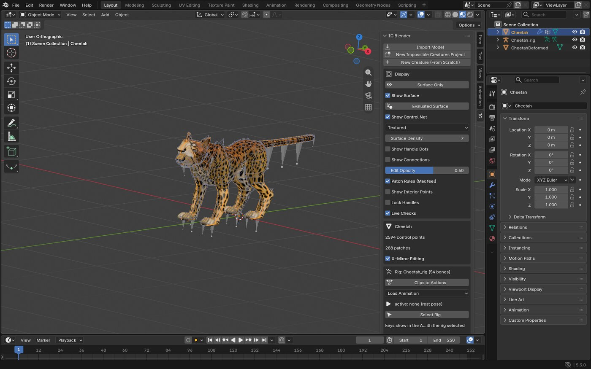
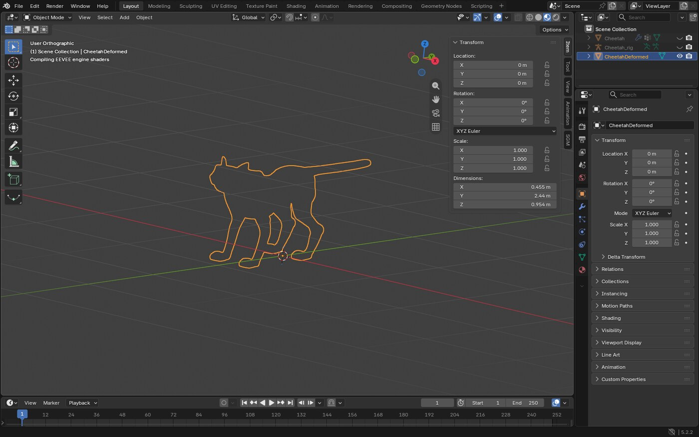
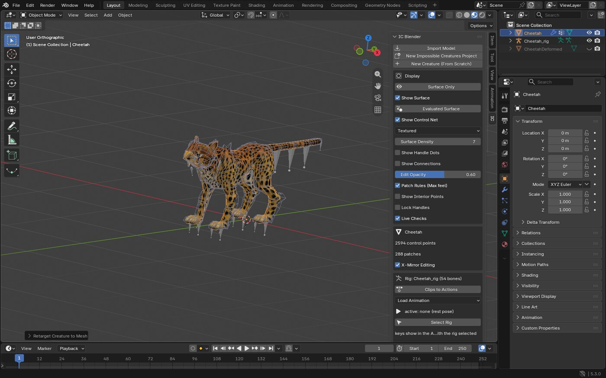
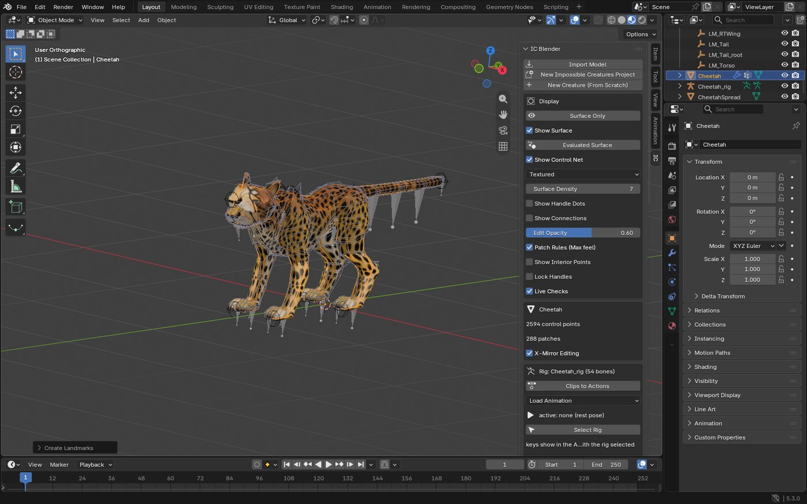
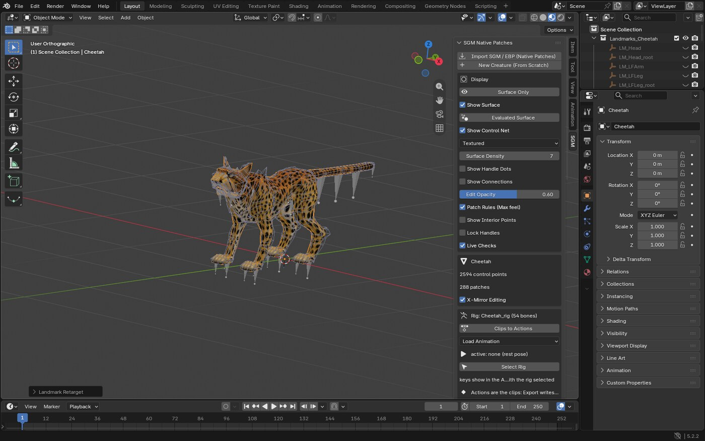
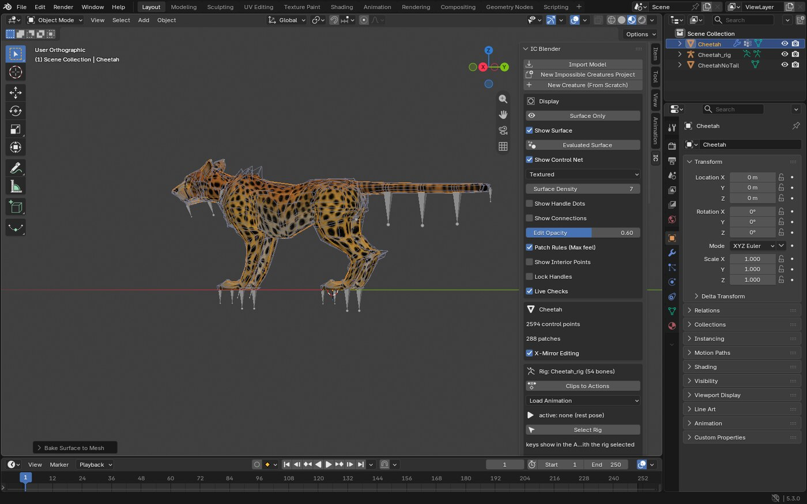
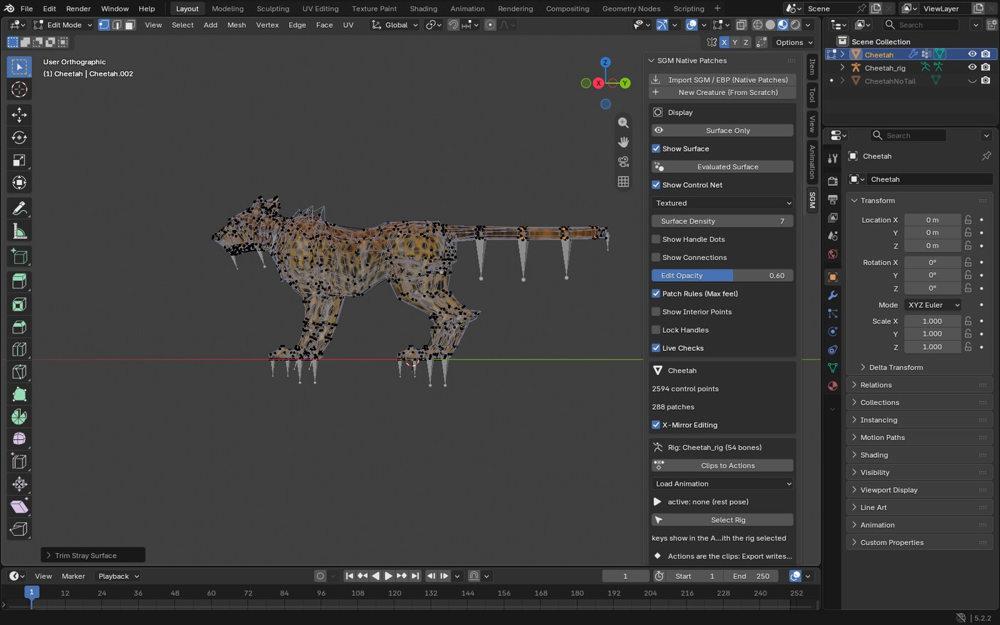
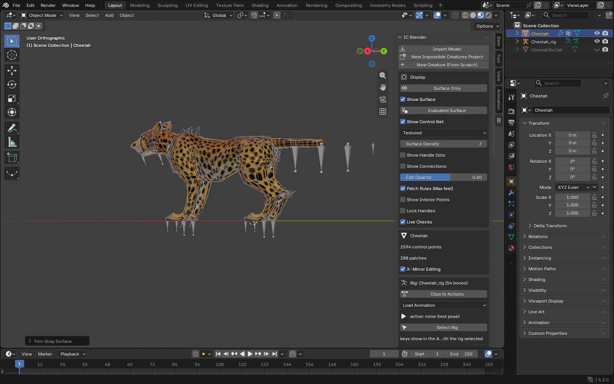

<!-- Written by build_guide.py from chapters/retarget.html: edit that file, not this one. -->

[Contents](README.md) · Previous: [Fitting a mesh: an outside model becomes a creature](fit.md) · Next: [Skinning and re-skinning](skin.md)

# Retargeting: an existing creature takes another shape

Retargeting keeps a working creature (patches, limbs, rings, skeleton, skin, clips) and reshapes its surface to match a target mesh. The tools are in the **Tools** box.

| Tool | Use it when |
| --- | --- |
| **Retarget Creature to Mesh** | the target is a similar shape |
| **Create Landmarks** + **Landmark Retarget** | parts must move across the body |
| **Trim Stray Surface** | the target lacks a part the creature has |

Fig. 71 · Set each tool's options in the redo panel (<kbd>F9</kbd>).

## Retarget Creature to Mesh

1. Add the target mesh: one closed skin (split seams are fine).
2. Select the creature and press **Retarget Creature to Mesh** in the box **Tools**. A small window opens: pick the **Target Mesh** and press **OK**. (If you select your mesh first and the creature last, the target is already filled in.)

Fig. 72 · The target mesh.

- **Pin Rings** (on): sockets stay put. Off may cause combine warnings.
- **Scale to Target** (on): aligns and resizes the target to the creature.
- **Keep Symmetry** (on): keeps a symmetric creature symmetric.
- **Move Bones** (on): bones follow the surface.
- **Seam Smoothness** (0): leave at 0 to keep stock-style seams.

Fig. 73 · The retargeted cheetah.

One Undo restores points and bones.

## The limit a closest-point fit has

Points move to the nearest part of the target, so use landmarks when limbs sit in different places.

## Create Landmarks and Landmark Retarget

1. Press **Create Landmarks**. It adds Empties named `LM_<name>` for limb tips, limb roots and the torso.
2. Drag each onto the matching place on the target. An Empty can also be named after a bone (`LM_endfeeler_l`).
3. Press **Landmark Retarget**. A small window opens: pick the **Target Mesh** and press **OK**. It warps surface and bones to the landmarks, then fits.

Fig. 74 · Landmarks placed on the target.

- **Warp Smoothing** (0.001): 0 hits every landmark exactly.
- **Warp Rings** (on): sockets follow the warp.
- Other options are as above.

Fig. 75 · The result of **Landmark Retarget**.

Check **coverage by limb** in the report: it warns which limbs still miss the target.

Limbs, sockets, bones and the walk stay those of the animal you started from. Choose that animal for its body plan.

## Trim Stray Surface

Retargeting ignores creature surface with no target under it. **Trim Stray Surface** finds it.

Fig. 76 · A target missing half the tail.

A patch is stray when at least **Stray Fraction** (half) of it lies farther than **Stray Distance** (2 % of size) from the target. The target defaults to the last fit or retarget mesh. Choose an action:

- **Select** (default): only selects the stray patches.
- **Delete**: removes them and fills the holes it can. Ring patches are refused. Undo takes several steps: one for the delete and one per filled hole (the report gives the number). Check for open sides.
- **Collapse onto Target**: folds them onto the body without changing the patches. Best for an unwanted limb. **Keep the Shared Edge** (on) leaves well-fitting neighbours still.

Fig. 77 · **Select** marks the extra tail.

Fig. 78 · **Collapse onto Target** folds the tail away.

**Validate** also warns about stray patches (*WARN trim*).

---

[Contents](README.md) · Previous: [Fitting a mesh: an outside model becomes a creature](fit.md) · Next: [Skinning and re-skinning](skin.md)
