[Contents](README.md) · Previous: [Sculpting: brushes instead of control points](sculpt.md) · Next: [Fitting a mesh: an outside model becomes a creature](fit.md)

# Making an animal from scratch: a rhino

This chapter builds a crude rhino: start a creature, shape it, add a horn bone, check limbs and skin, animate, combine and export.

## What the scaffold gives you

**New Creature (From Scratch)** writes a complete creature to the `.sgm` you choose and imports it. At Detail 1 it has:

- a 48-bone skeleton;
- a closed body of 248 patches with torso, head, tail and four legs;
- 13 limbs (wings and front arms are empty stubs) and 12 connection rings;
- a labelled checker texture;
- the 8 standard clips and the base-game IK chains.

The options are *Name*, *Detail* 1–3 (1 is coarsest), *Standard Clips*, *IK Chains* and *Clips as Actions*.

## 1. New Creature (From Scratch)

1. Press <kbd>N</kbd> and open the **IC Model** tab.
2. Click **IC Model** tab > **New Creature (From Scratch)**.
3. Set *Name* to `Rhino`, keep *Detail* 1, save as `rhino.sgm`.
4. Set the shading to *By Limb* and tick *Show Connections*.

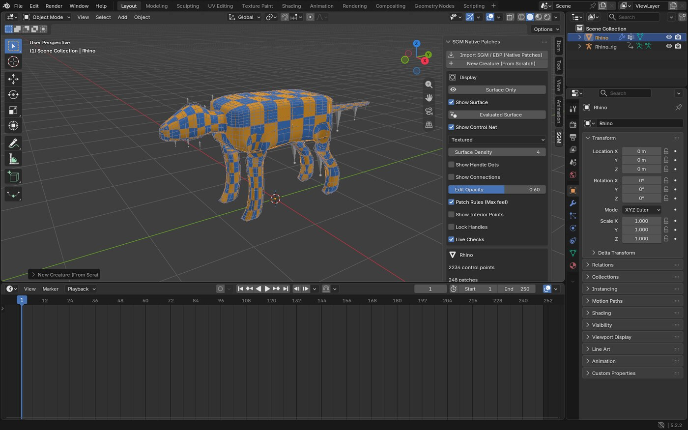

Fig. 52 · The new scaffold.

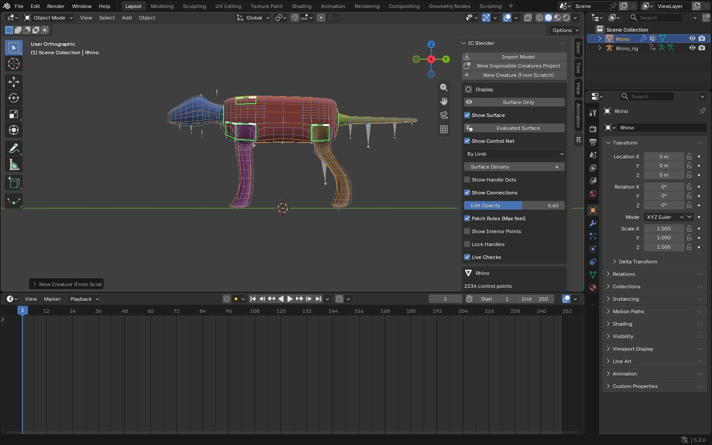

Fig. 53 · Limb colours and connection rings.

## 2. Shape it in Edit Mode

Dragging shared points keeps the surface closed. *X-Mirror Editing* is on.

1. Press <kbd>Tab</kbd> and tick *Show Handle Dots*.
2. Move with <kbd>G</kbd> and scale with <kbd>S</kbd>. **Boner > Limbs > Select Limb** selects a body part; proportional editing (<kbd>O</kbd>) keeps it smooth.
3. For a rhino, make it lower and wider, enlarge and lower the head, shorten the tail and thicken the legs.
4. Press <kbd>Tab</kbd> to check the shape.

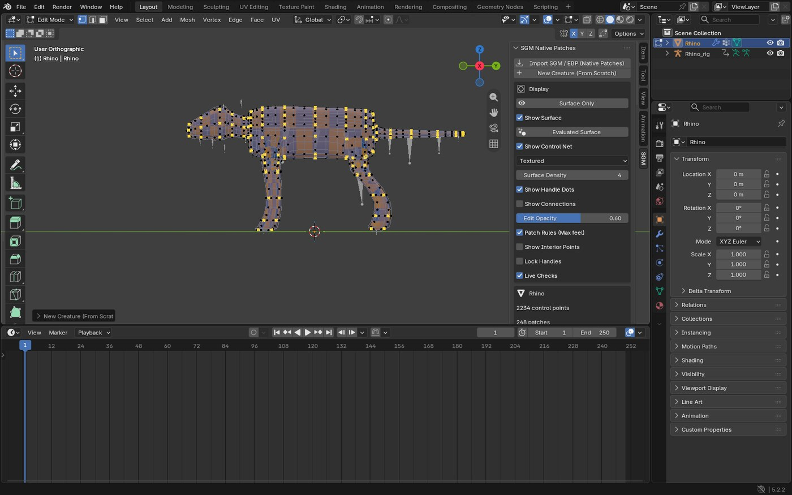

Fig. 54 · Before shaping.

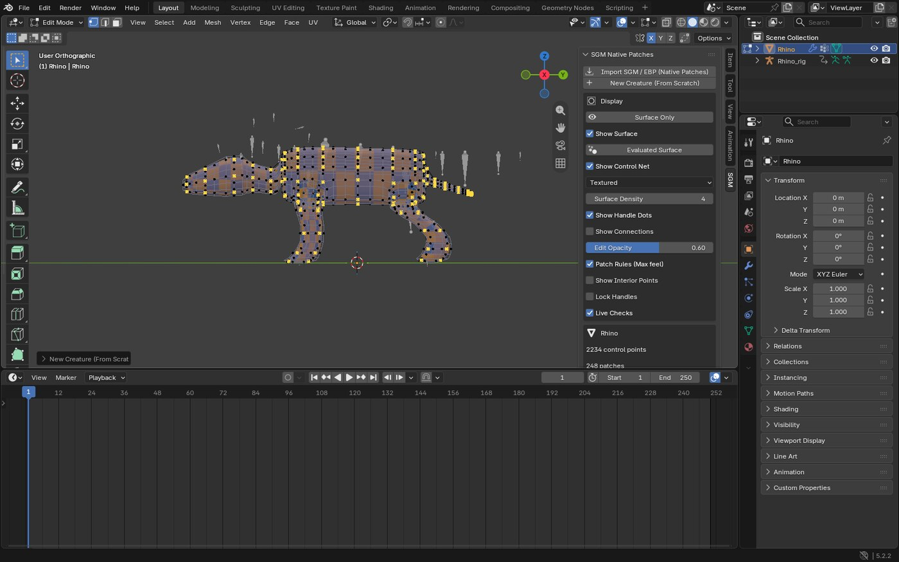

Fig. 55 · After shaping; the bones have not moved.

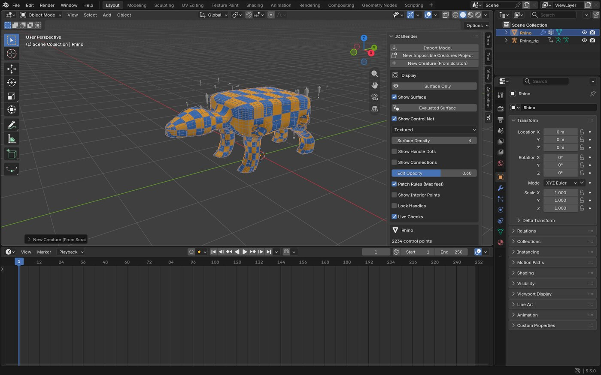

Fig. 56 · The rough rhino.

Moving points does not move bones: edit the armature. Export gives the clips it keeps new bounds when the body's size changed, so no re-keying is needed for that.

## 3. A horn: pull it out, give it a bone, skin it

**Extrude Patch** needs an open side and the scaffold is closed, so pull the horn from existing points.

1. In Edit Mode select the top-front points of the head.
2. Press <kbd>G</kbd> and drag them forward and up. Keep them selected.
3. In Object Mode, set **Boner > Bones** > *Bone* to `head` (or use *Pick Bone*). Click **Add Bone under Active**, set *Name* `horn`, an *Offset* and a *Length* such as 0.25 m.
4. Press <kbd>Tab</kbd> and click **Assign Selected**.

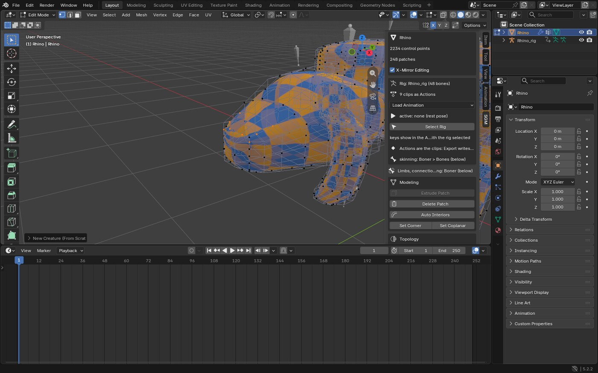

Fig. 57 · The horn points selected.

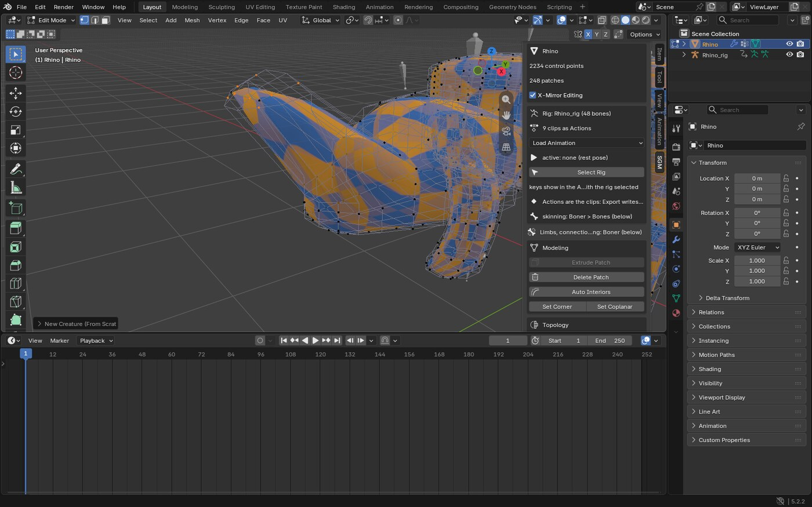

Fig. 58 · The pulled horn.

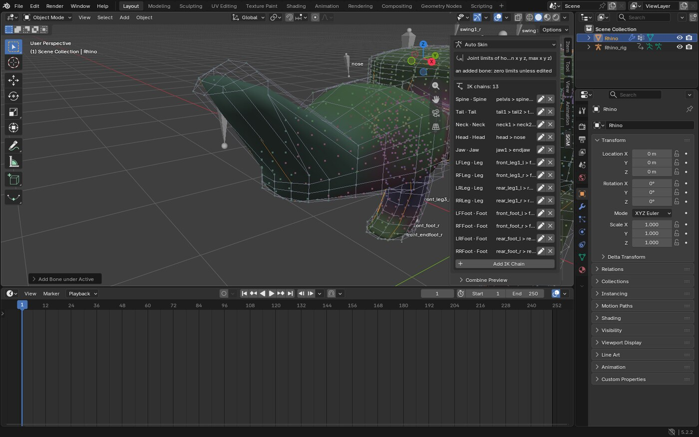

Fig. 59 · The new `horn` bone, with no points yet.

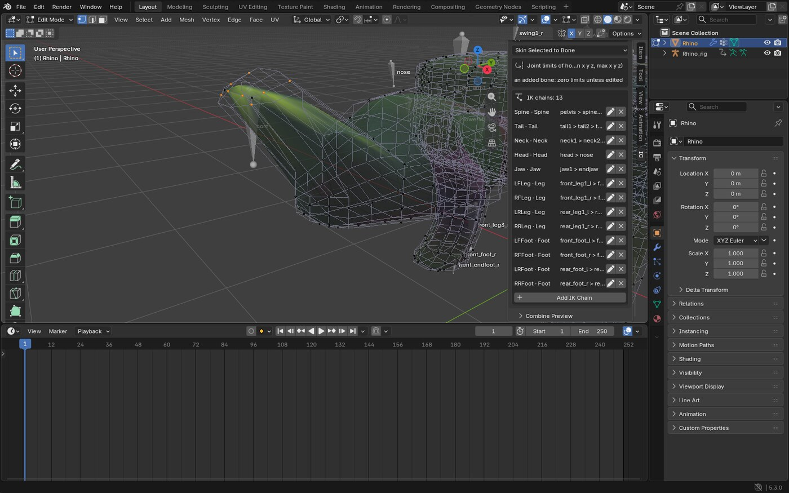

Fig. 60 · The points now belong to `horn`.

## 4. Limbs and connections

The scaffold already has these, so just check them in **Boner**.

1. **Limbs** lists each limb's class, patches, bones and status.
2. Click a limb to see its *Side / Position / Plane / Type / Non-Swappable* settings and bones, with *Select Bones*, *Set Root Bone*, *Add Active Bone* and *Remove Active Bone*.
3. Click **Rename** and enter `Rhino_HornedHead`. Combining uses a limb's class, not its name.
4. **Connections** lists the rings. With *Show Connections* on, click a row to highlight it.

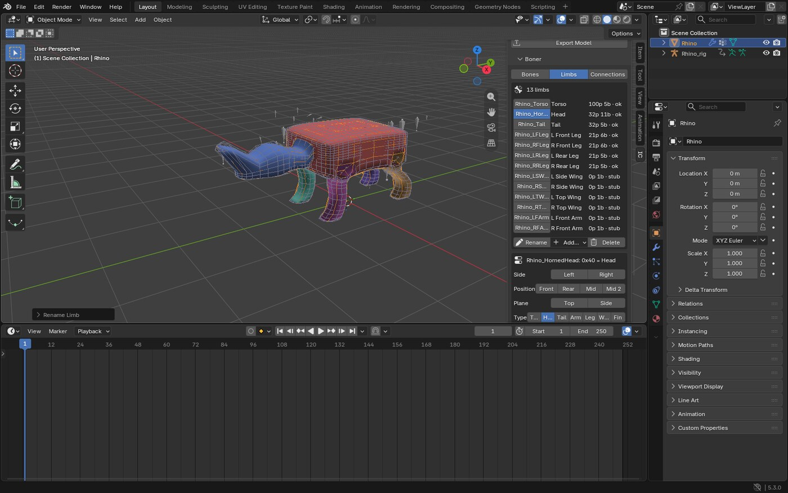

Fig. 61 · The Limbs tab after renaming.

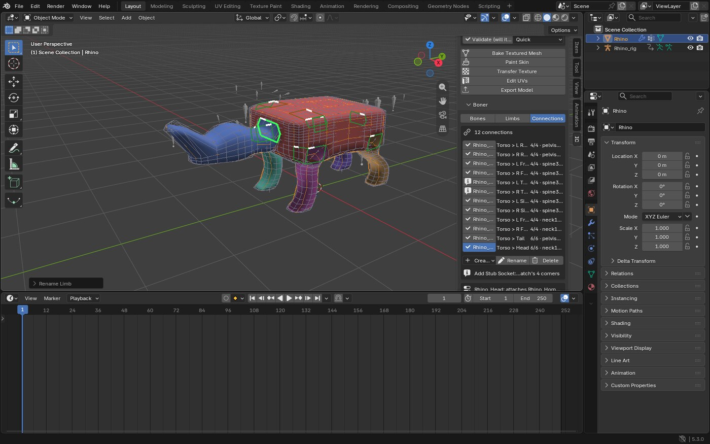

Fig. 62 · The head's connection ring.

## 5. Skinning: is every point on a bone?

The scaffold is fully skinned. Export refuses patch points that have no bone.

1. Use *By Bone* shading; points with no bone are orange.
2. In Edit Mode click **Select** next to *Unassigned*.
3. Click **Assign Selected**, or **Auto Skin > Selected, else Unassigned**. *Auto Skin > Reset All* replaces the whole skin, so check the result. **Remove from Bone** unassigns.

## 6. Animation

1. Choose **Load Animation > Idle1** and press <kbd>Space</kbd>.
2. See the keys in a Dope Sheet with *Only Show Selected* off, or click **Select Rig** and use the Action Editor.
3. For a new clip, select the rig, create an Action named `headbob`, enter Pose Mode (<kbd>Ctrl</kbd>+<kbd>Tab</kbd>) and key the rotation of `neck2`, `neck3` and `head` at frames 1, 11 and 21, head down at 11.
4. Export adds it as a new clip. For the game to play it, it also needs a motion: see [Animations and motions](anim.md).

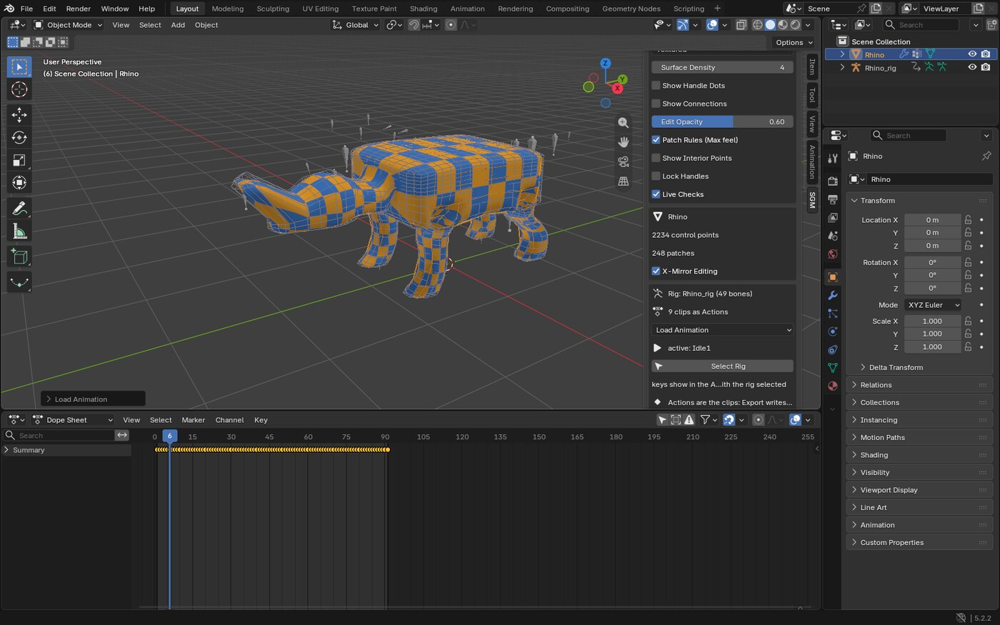

Fig. 63 · The *Idle1* clip.

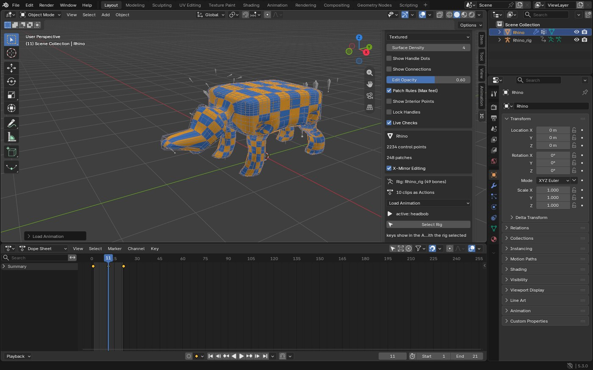

Fig. 64 · The new `headbob` clip.

Only the rig's active Action, Actions on its NLA tracks and imported ones are exported.

## 7. Validate, Combine Preview, Export

1. Press **Validate (will it load?)** with *Combine Checks* on *Quick*. One warning is expected and does not block: no `.lua` file (a combine keeping these legs gets zero ground speed).
2. In **Combine Preview** choose *This Creature Is the Torso*, *Stock*, `bull`, tick only *Head* and click **Preview**.
3. Click **Export Model** and save as `rhino_done.sgm` (a model file you can open again later).

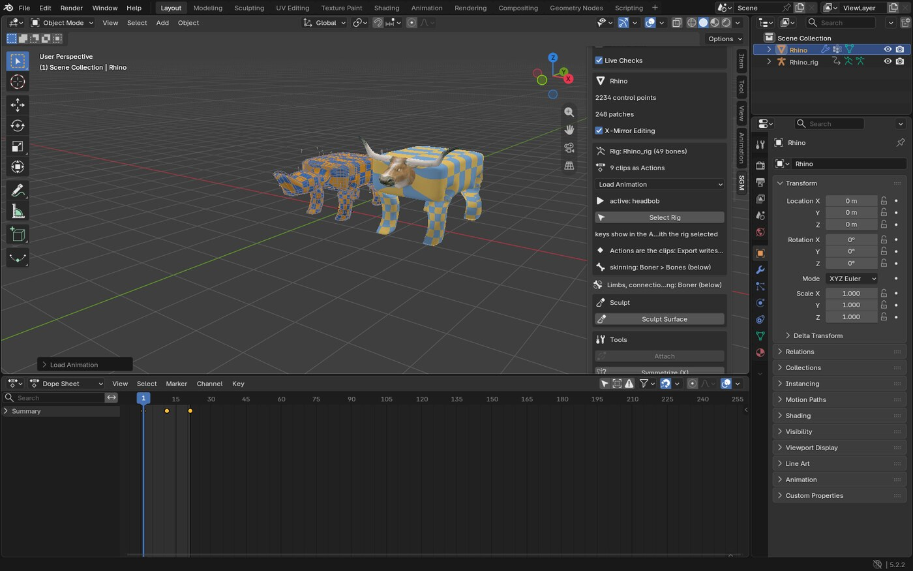

Fig. 65 · Rhino torso with a bull head.

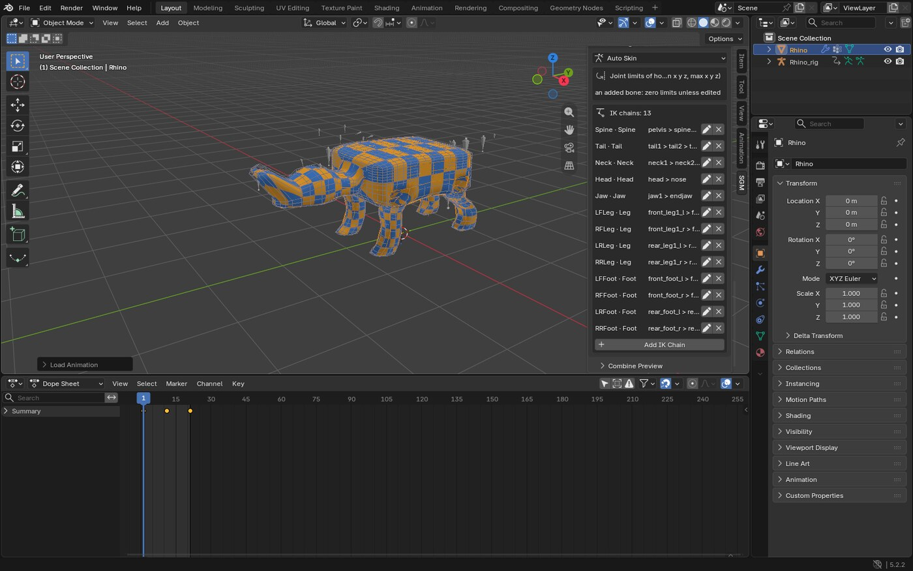

Fig. 66 · Ready to export.

## 8. Take it into the game

A creature built from the template has no game animal behind it, so the export has no original to copy. It makes the blueprint for you, from your clips, and starts the numbers from the cheetah's. The export window says so (“Built from nothing: a generated blueprint”; the field **Start stats from** lets you pick another animal to start the numbers from).

1. Open the **IC Game** tab, **Game** panel. Press **Check the Creature**.
2. Press **Export Creature for the Game**. Give it a name such as `my_rhino` and a display name, leave **Install into the game after export** ticked, and press **OK**.
3. Start the game.

The chapter [A new creature from a game animal](newcreature.md) shows these steps in full. The template's skin is a plain checker pattern, so a combined creature looks patchy.

---

[Contents](README.md) · Previous: [Sculpting: brushes instead of control points](sculpt.md) · Next: [Fitting a mesh: an outside model becomes a creature](fit.md)
