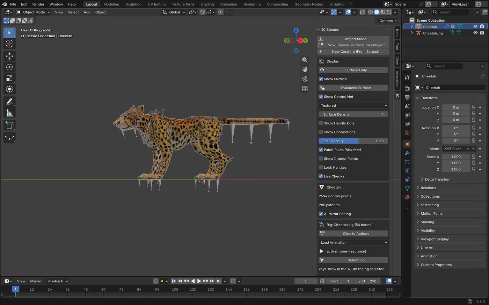
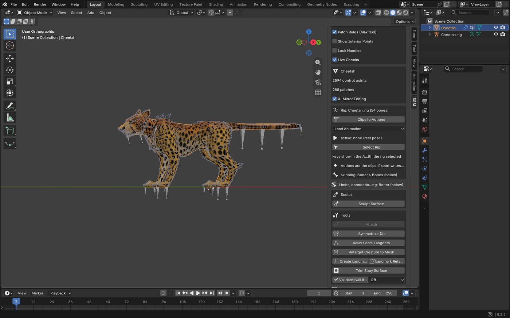
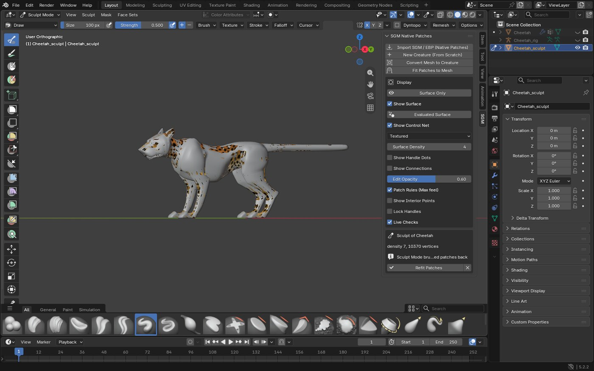
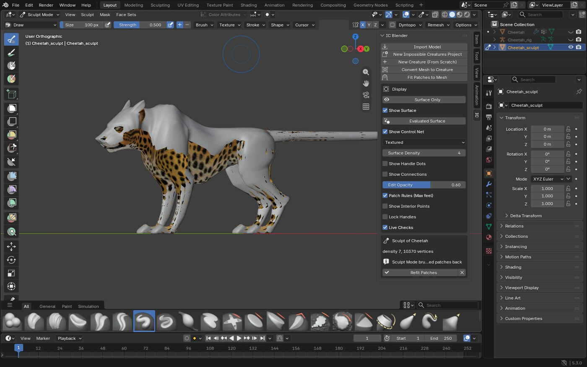
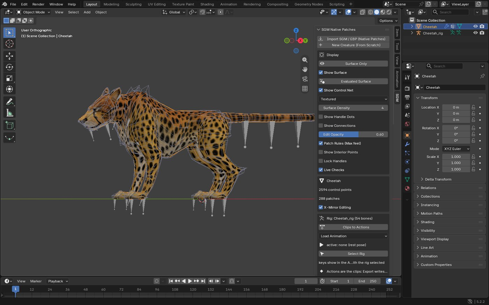
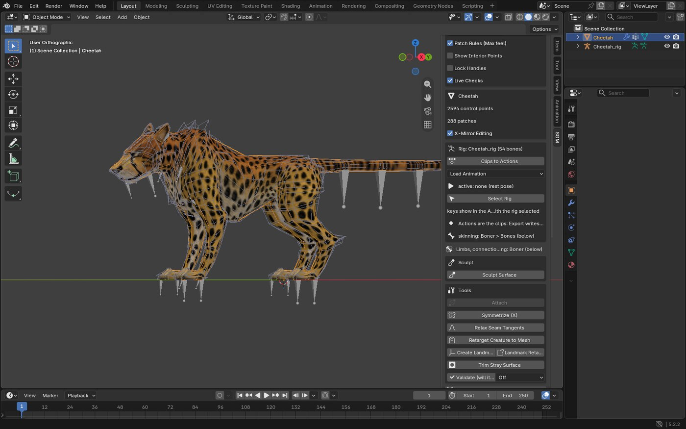

[Contents](README.md) · Previous: [Topology: making geometry, not just moving it](topology.md) · Next: [Making an animal from scratch: a rhino](scratch.md)

# Sculpting: brushes instead of control points

Shape a creature with Sculpt Mode brushes, then fit the result back into its patches. Everything else stays, and untouched patches keep their exact points. The example is `cheetah.sgm`.

Fig. 46 · The cheetah before sculpting.

## Sculpt Surface

1. In the **Sculpt** box press **Sculpt Surface**.
2. Set **Density** in the redo panel (<kbd>F9</kbd>; 4–12, default 7). Higher gives finer vertices, not finer patches.
3. A joined mesh named `<creature>_sculpt` is made, so brushes do not tear the seams.
4. The creature and rig are hidden and Sculpt Mode starts.

Fig. 47 · The **Sculpt** box.

Fig. 48 · The sculpt mesh in Sculpt Mode.

## Sculpt it

Use any brush or mask that only moves vertices.

Fig. 49 · A hump made with Grab.

While sculpting, keep the topology (no Dyntopo, Remesh or deleting) and leave the sculpt object where it is.

## Refit Patches

1. Press **Refit Patches**.
2. Only patches you changed are refitted.
3. Check the **residual** in the report: the detail the patches could not hold.
4. One <kbd>Ctrl+Z</kbd> undoes it. The sculpt mesh is removed unless **Keep Sculpt Mesh** (redo panel) is on.

Fig. 50 · The creature now has the sculpted shape.

Fig. 51 · Export rewrites only the changed points.

## Reading the residual

Broad changes fit closely. Scales, wrinkles and sharp creases come out smoother. Either subdivide those patches first (see [Topology](topology.md)) or paint the detail (see [Textures](texture.md)).

Finish with **Refit Patches** or **Discard Sculpt** (the **X** next to Refit Patches) before you export.

---

[Contents](README.md) · Previous: [Topology: making geometry, not just moving it](topology.md) · Next: [Making an animal from scratch: a rhino](scratch.md)
