<!-- Written by build_guide.py from chapters/skin.html: edit that file, not this one. -->

[Contents](README.md) · Previous: [Retargeting: an existing creature takes another shape](retarget.md) · Next: [Re-texturing and texturing from scratch](texture.md)

# Skinning and re-skinning

Skinning decides which bone moves each control point. The tools are in the **IC Model** tab under **Boner > Bones**. The examples use the stock `rhinoceros.sgm`.

## The model: one bone per point, no weights

- Each control point follows exactly one bone. There are no blended weights.
- In Blender each bone has a vertex group, used at weight 1.0.
- Every point a patch uses needs a bone, or Export refuses.

## Seeing the skin: By Bone

1. Import the rhinoceros (**IC Model** tab > **Import Model**) and open the sidebar (<kbd>N</kbd>) on the **IC Model** tab.
2. Open **Boner** and choose the **Bones** tab.
3. Set **Overlay** to **By Bone**. Points take their bone's colour; points with no bone are orange.

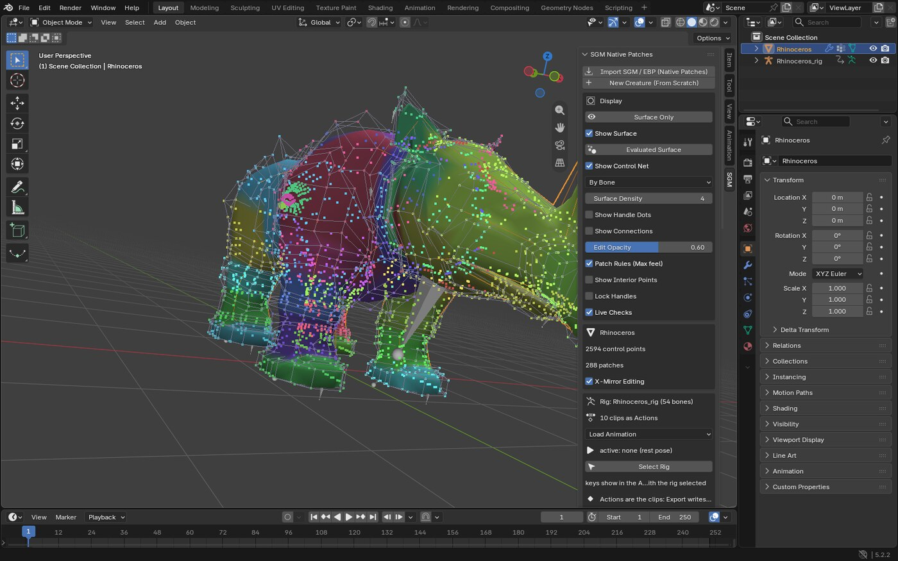

Fig. 79 · By Bone colours every point by the bone that owns it.

4. Pick a bone in the **Bone** field (here `head`). Its points turn bright, the others dim, and the tab shows its point count and parent.

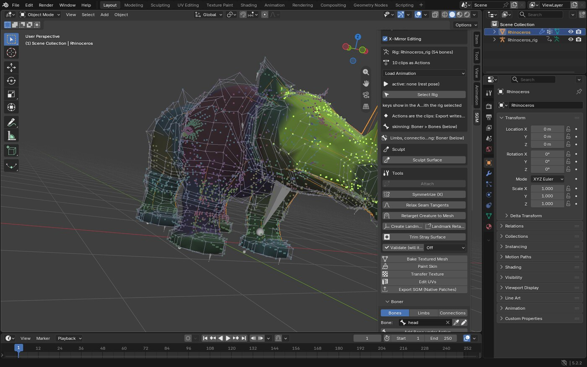

Fig. 80 · The active bone, `head`, stands out.

## Selecting a bone's points, and Pick Bone

1. Press <kbd>Tab</kbd> for Edit Mode. **Assign Selected**, **Select Points** and **Remove from Bone** appear on the tab.
2. Press **Select Points** to select the active bone's points. *Extend*, in the redo panel, adds to the selection.

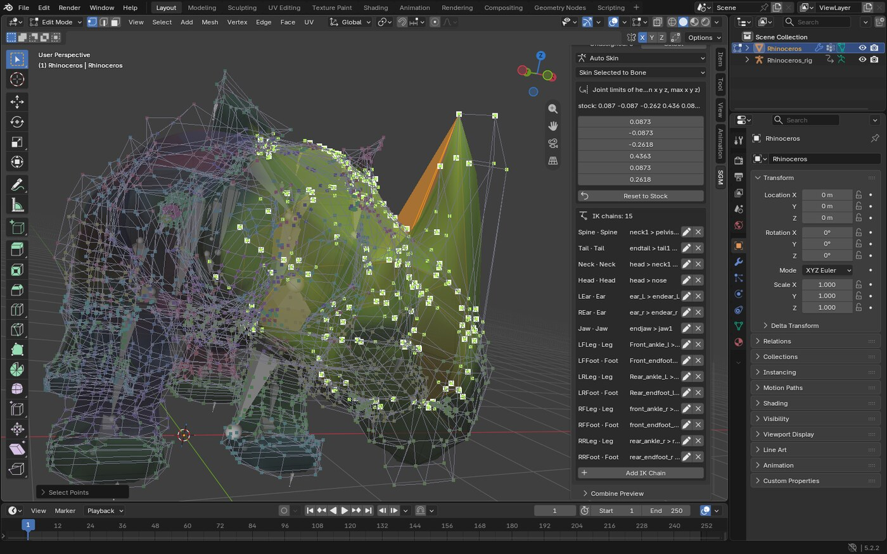

Fig. 81 · Select Points selects everything the active bone owns.

3. To find a point's bone, press the eyedropper (**Pick Bone**). Hover a point or rig bone to see the name in the viewport header. Click to make it active, or press <kbd>Esc</kbd> to cancel. You can orbit while picking.

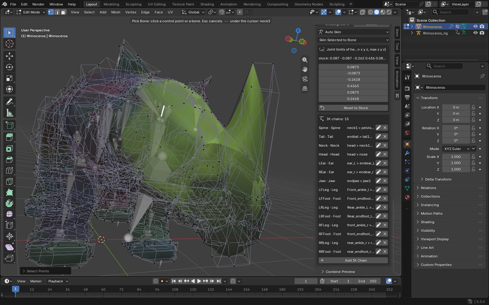

Fig. 82 · Pick Bone highlights the whole bone under the cursor.

## Moving points to a neighbouring bone

To see the skin bend, press **Select Rig**, enter Pose Mode and rotate `head` (<kbd>R</kbd>).

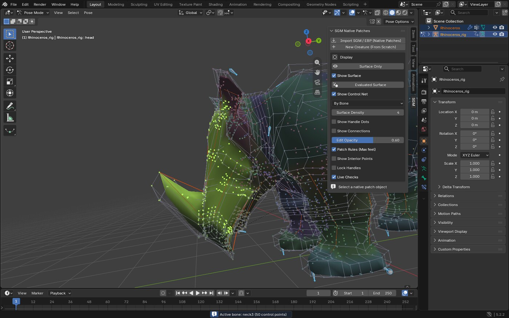

Fig. 83 · Stock skin with the head nodded down.

1. Reset the pose (<kbd>Alt</kbd>+<kbd>R</kbd>), select the creature and enter Edit Mode.
2. Select the points to move (here 20 lower-neck points of `neck3`).
3. Make `head` the active bone and press **Assign Selected**. Or use **Skin Selected to Bone**, under Auto Skin, and choose the bone from a list.

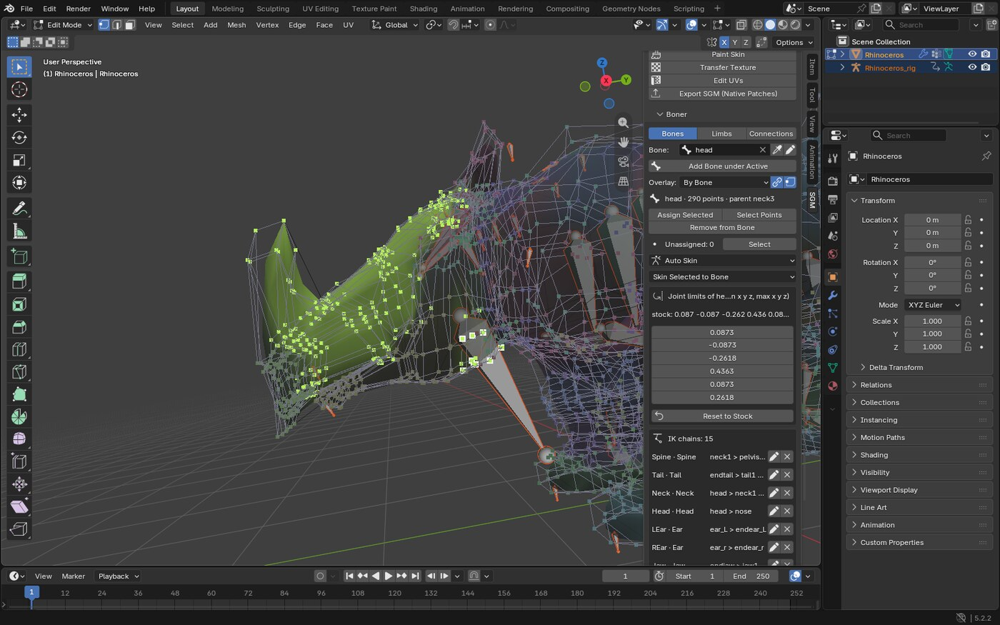

Fig. 84 · The selected neck points now belong to `head`.

4. Pose the head again: the moved points now swing with it. <kbd>Ctrl</kbd>+<kbd>Z</kbd> undoes an assignment.

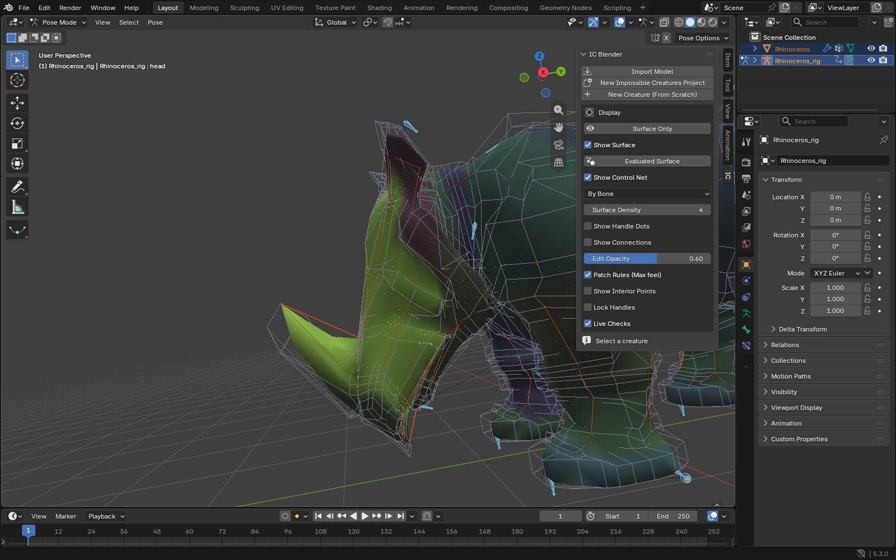

Fig. 85 · The same pose now pulls the lower neck along.

Points can be assigned only to bones with **Deform** ticked.

## Taking points off a bone: Remove from Bone, Select Unassigned, and the export refusal

1. Make `ear_L` active, press **Select Points**, then **Remove from Bone**. The points turn orange and *Unassigned* turns red. Selected points of other bones are left alone.

2. **Export Model** now writes nothing, and **Validate (will it load?)** reports that export is blocked.
3. Press **Select** next to the Unassigned count (**Select Unassigned**). Then assign the points to a bone, or run Auto Skin.

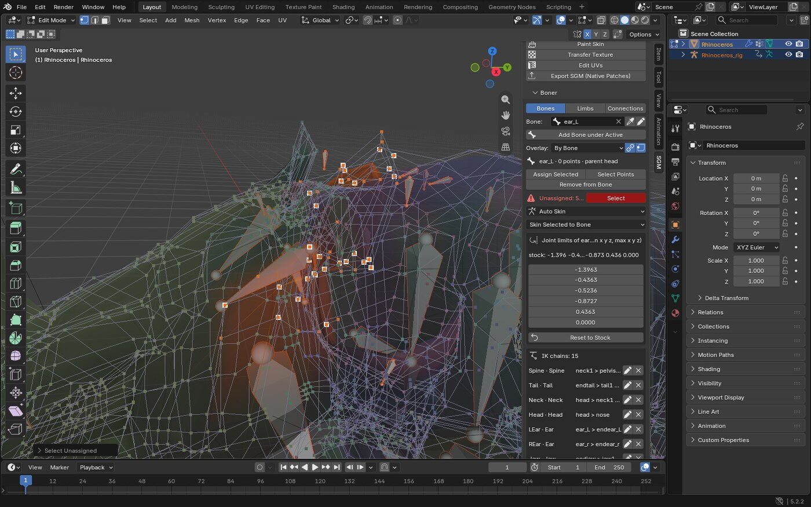

Fig. 86 · Select Unassigned picks every point with no bone.

## Auto Skin

**Auto Skin** gives each point its nearest bone. Choose which points:

- **Selected, else Unassigned** (default): the selected points in Edit Mode. With none selected, or in Object Mode, every unassigned point.
- **Selected** (Edit Mode only).
- **Unassigned**.
- **Reset All**: every point, replacing the current skin.

It skips stub bones (wing and arm sockets), end bones (names such as `endjaw`) and bones with Deform off. Keep **Handles Follow Corners** (redo panel) on: otherwise patches can bend differently in battle.

1. With the ear points still selected, run **Auto Skin > Selected, else Unassigned**. Check the result with By Bone.

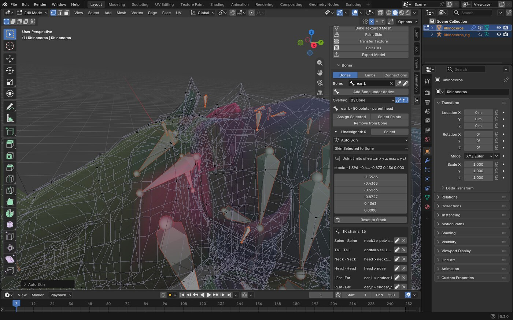

Fig. 87 · Auto Skin gives each orange point its nearest bone.

2. **Reset All** re-skins the whole creature. It matches only about half of a stock skin, so fix seams by hand. With every point selected, the two "Selected" choices refuse.

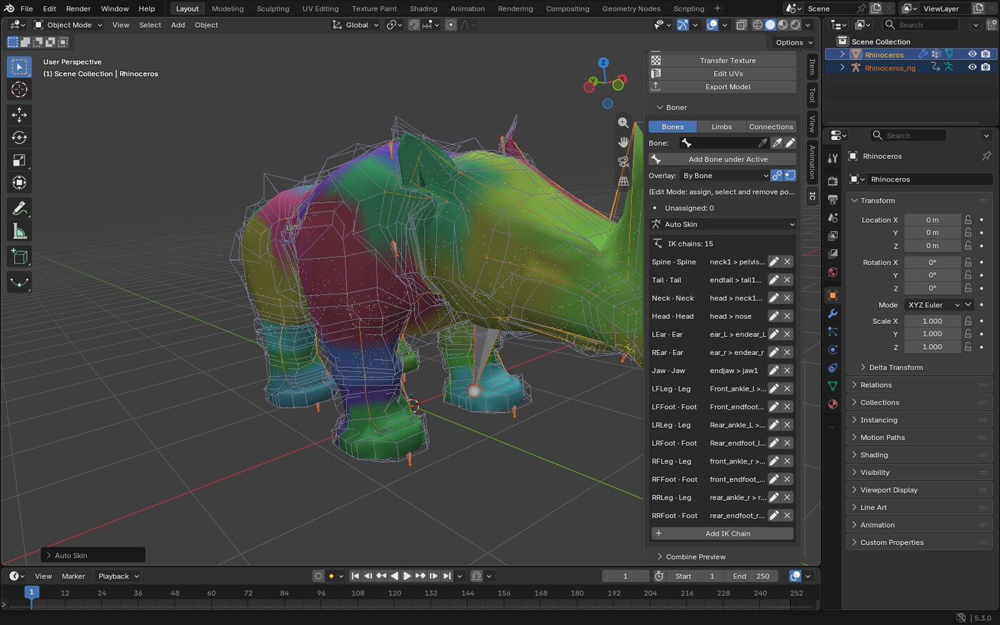

Fig. 88 · Reset All replaces the whole skin.

## Blender's own way: vertex groups and weight painting

Blender's vertex-group tools work too, if each point ends up in one bone group at weight 1.0.

1. In Edit Mode, select points. Remove them from the old group and assign them to the new one at weight **1.0** (Object Data properties, or <kbd>Ctrl</kbd>+<kbd>G</kbd> > *Assign to Active Group*).
2. By Bone shows the new owner at once, and Export keeps the change.

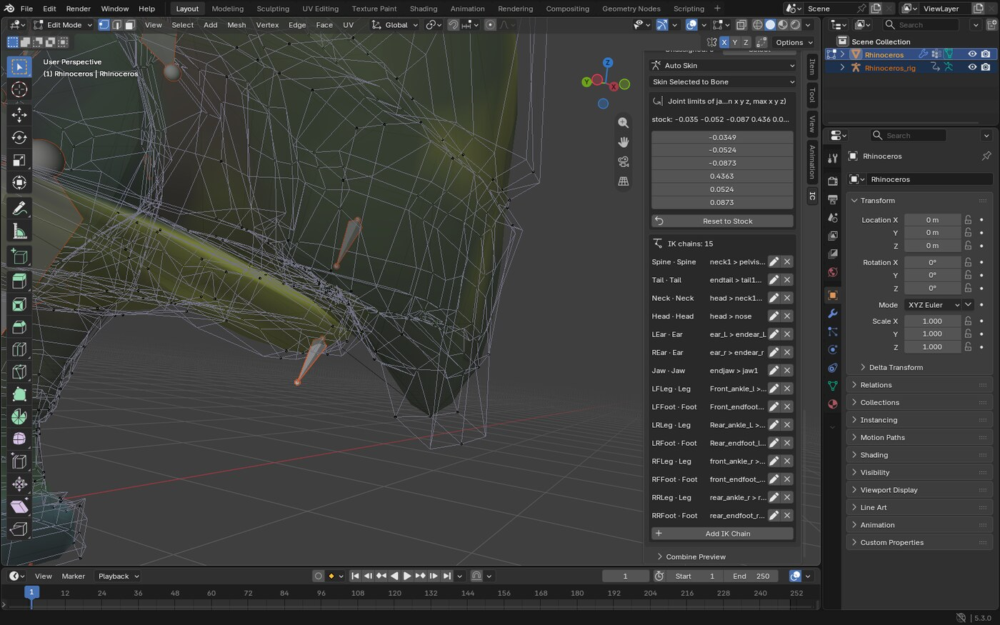

Fig. 89 · Points moved with vertex groups show under their new bone.

3. A point in two groups, at partial weight or in no bone group can't be exported. Other skin edits stop too.
4. Press <kbd>Ctrl</kbd>+<kbd>Z</kbd>, or select the point and press **Assign Selected**. **Select Unassigned** finds points in no group.

## Export: the summary line

Press **Export Model**. The report names what changed, for example `skinning: 35 bone range(s) rebuilt`. A high count is normal after a small edit.

## Skinning and combining

The combiner moves a limb by its bone list. Skin a limb's patch points only to:

- the limb's own bones;
- `pelvis`, `spine1`, `spine2`, `spine3`, `neck1` or `tail1`;
- its connection's host bone.

Warnings:

- Other points go to the root bone when the limb is grafted (for a leg, the combiner fails). Re-skin them, or add their bone to the limb (**Boner > Limbs > Add Active Bone**).
- Don't skin points to a stub bone, and don't leave a connection's host bone without points.
- **Validate** reports these as *STOCK* lines. Export still works, but the creature won't combine like a stock one.

To select interior points, tick **Display > Show Interior Points**.

Add and remove patches with the Modeling and Topology tools, not Blender's delete, merge or sort.

---

[Contents](README.md) · Previous: [Retargeting: an existing creature takes another shape](retarget.md) · Next: [Re-texturing and texturing from scratch](texture.md)
