[Contents](README.md) · Previous: [Skinning and re-skinning](skin.md) · Next: [Bones, limbs and connections (Boner)](boner.md)

# Re-texturing and texturing from scratch

Paint a creature's textures or move its UVs, then export. The examples use the stock `rhinoceros.sgm`.

## How textures live in the .sgm

- Textures are inside the `.sgm`. Import makes each a Blender image named `SGM_<file>`.
- Keep sizes powers of two. A texture holds at most 256 colours.
- Each patch uses one material, and each material names a texture.
- Pure magenta (255, 0, 255) is transparent in game.

## Seeing the textures: the live overlay

1. Use **IC Model** tab > **Import Model** and pick `rhinoceros.sgm`.
2. The shading selector in **Display** starts on **Textured**.
3. Choose **Plain**, **By Limb** or **By Bone** to check shape or ownership.

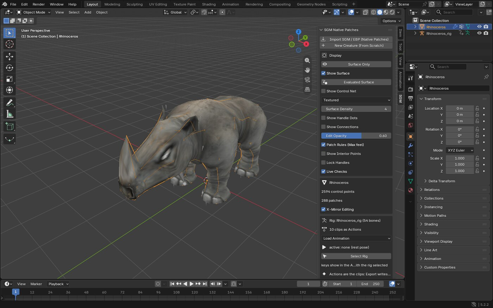

Fig. 90 · Textured shows the creature's own skins.

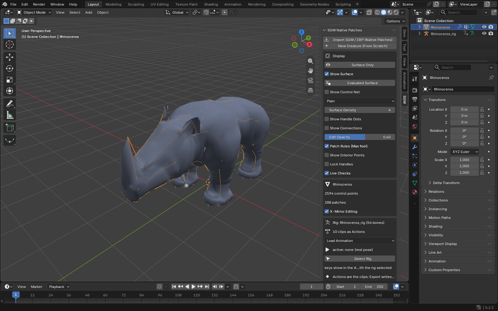

Fig. 91 · Plain shows the bare surface.

To view a texture, open an **Image Editor** and pick its `SGM_…` image.

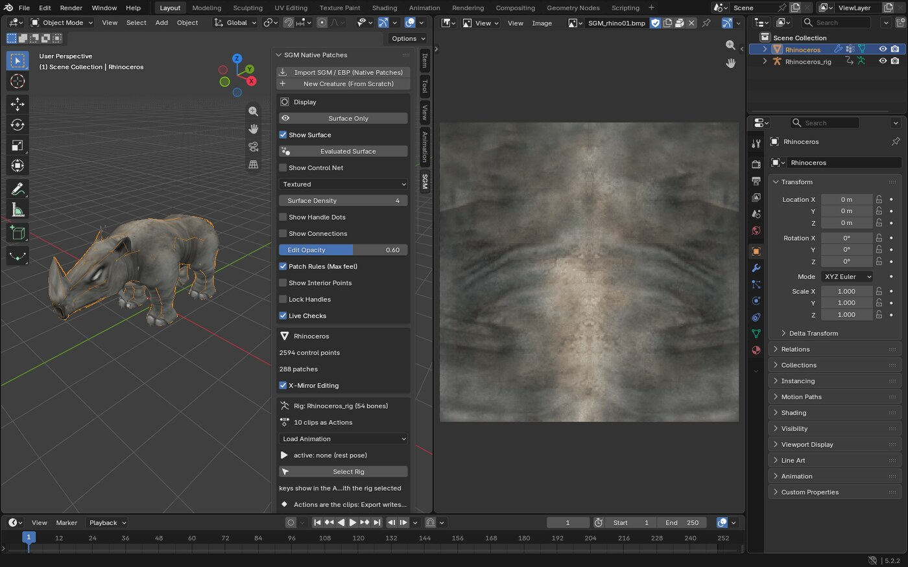

Fig. 92 · Each texture is a Blender image.

## Paint Skin: repainting a texture

1. With the creature active, press **IC Model** tab > **Paint Skin**. It makes a `<creature>_baked` mesh and enters **Texture Paint**.
2. Paint on the mesh, or in the Image Editor in **Paint** mode. Use pure magenta for transparency.
3. Return to Object Mode. The baked mesh is only for painting and is never exported.

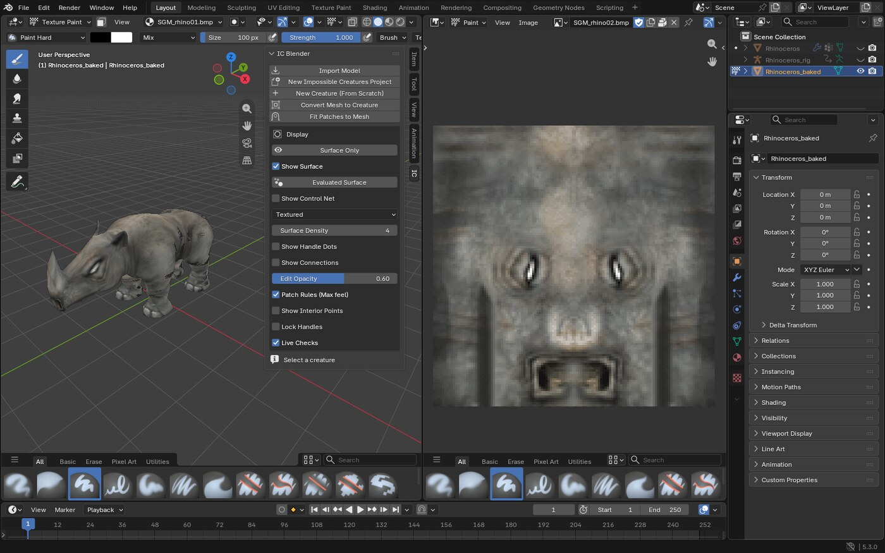

Fig. 93 · Paint Skin opens the baked mesh for painting.

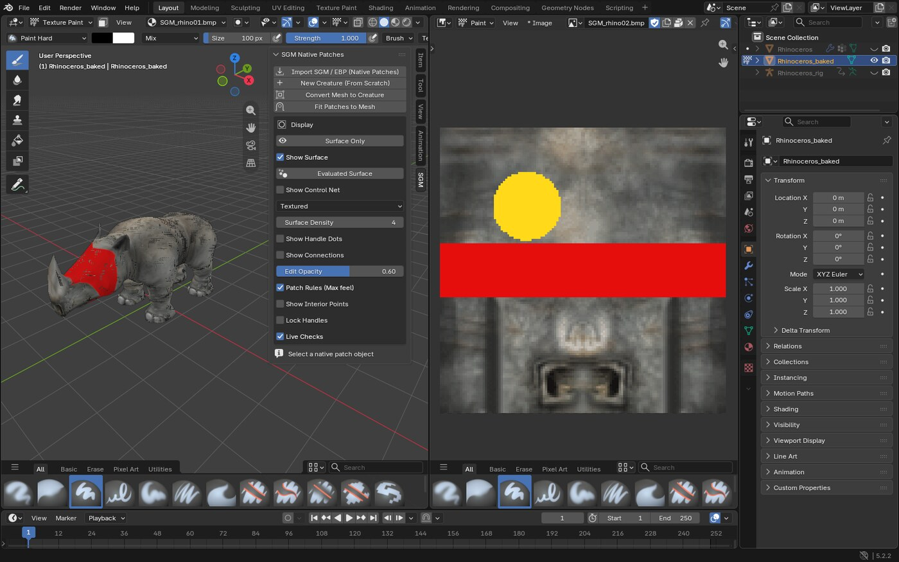

Fig. 94 · Paint appears on the creature at once.

**Paint Skin** reuses an existing baked mesh; delete it after moving control points.

## Export: only painted textures are re-encoded

1. Select the *creature*, then press **IC Model** tab > **Export Model**.
2. The report lists what changed, for example `textures: 1 edited (rhino02.bmp: 3812 texels)`.

Unpainted textures are unchanged. A painted one keeps its palette where possible. An image whose size changed gets a new palette. When more than 5 % of the texels changed (a repaint rather than a brush stroke), Export encodes the skin both ways, keeping the old palette and quantising the whole picture afresh, and writes the one whose colours are closer to your picture; when the fresh one wins, the report says so with both errors.

## Load Skin Image: a picture file as the skin

To use a picture made elsewhere, press **IC Model** tab > **Load Skin Image** (next to **Paint Skin**) and pick a PNG, JPEG, TGA or BMP. **Skin** chooses which texture it replaces when the creature has several. A picture of another size is scaled to the skin's size (**Resize To The Skin**; off refuses it). The picture goes into the skin image, so Paint Skin continues from it, and Export writes it into the texture as above.

## UV editing: the UV cage

Each patch has one UV point per corner.

1. With the creature active, press **IC Model** tab > **Edit UVs**. It makes a `<creature>_UVcage` mesh with one quad per patch.
2. In Edit Mode on the cage, select faces and open the **UV Editor**. Pick the texture, then move, rotate or scale the UVs.
3. Return to Object Mode, select the creature and press **Apply UVs**. This is optional before Export, which reads the cage too.
4. Export reports the changed patches, for example `UVs: 62 patches`.

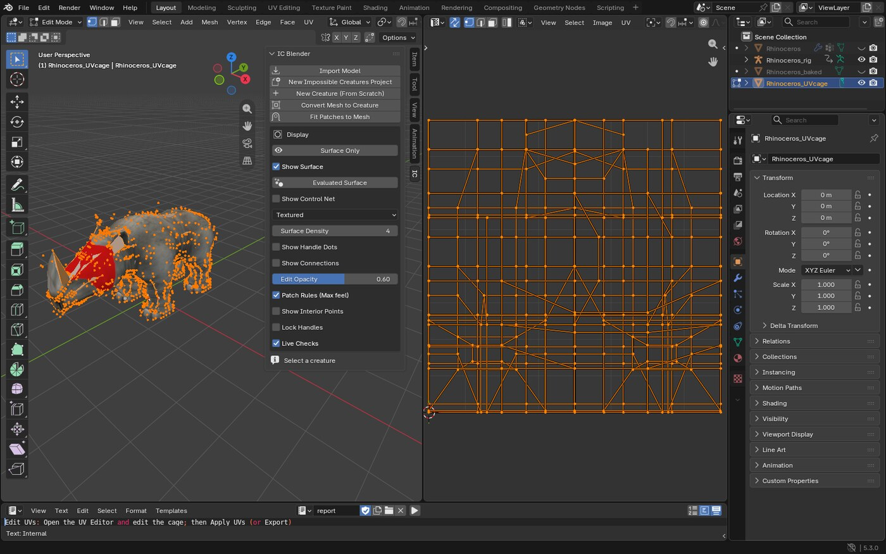

Fig. 95 · The cage shows its UVs in the UV Editor.

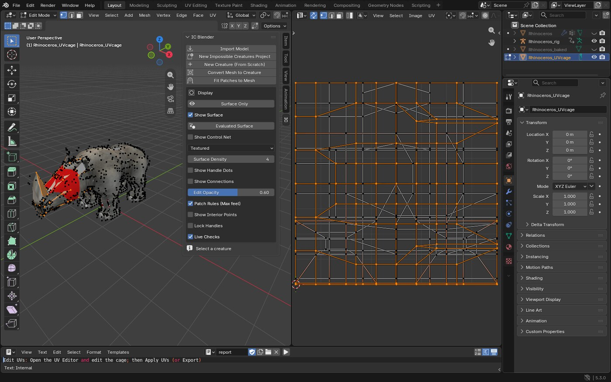

Fig. 96 · The head UVs are rotated a quarter turn.

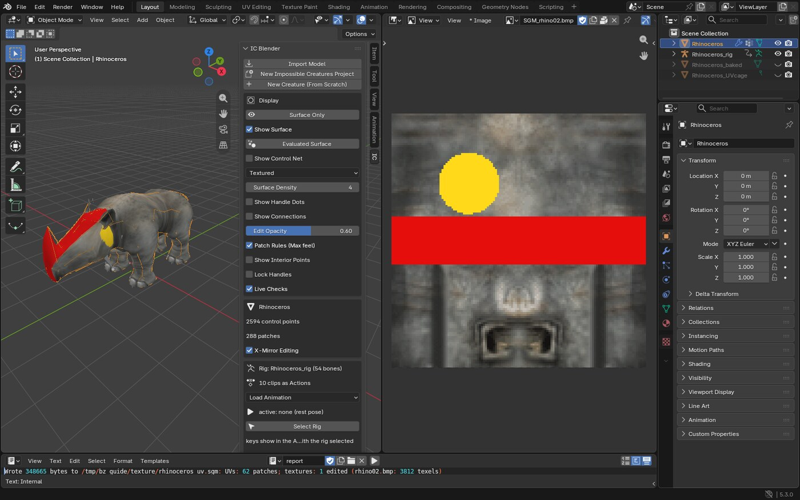

Fig. 97 · Apply UVs updates the creature.

## Texturing from scratch

You can't add materials or textures by hand, so start from a creature with the slots you need.

1. Press **IC Model** tab > **New Creature (From Scratch)**. Set **Name**, keep **Standard Clips**, **IK Chains** and **Clips as Actions** on, and choose where to save the `.sgm`. **Detail** 1 is the coarsest body; 3 has three times the patches, so the checker lands differently.
2. It has one 256x256 checker texture on every slot, named after the creature in lower case: `<name>01.bmp`, for example `newcreature01.bmp`. Its Blender image is `SGM_newcreature01.bmp`.
3. Paint over it with **Paint Skin**.

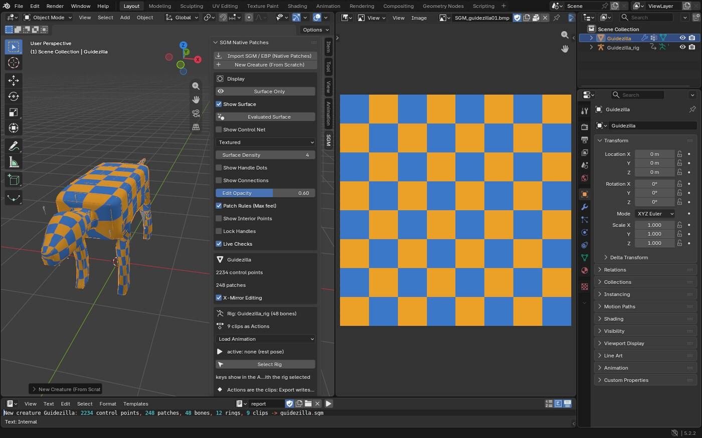

Fig. 98 · The checker shows where the UVs land.

**To use your own PNG**, copy its pixels into the creature's image; a newly opened image isn't exported.

1. Use **Image > Open** in an Image Editor.
2. Resize it to match the creature's image (**Image > Resize**).
3. In the Python Console: `src = bpy.data.images["skin.png"]; dst = bpy.data.images["SGM_newcreature01.bmp"]; dst.pixels = src.pixels[:]` (use your creature's name in lower case in place of `newcreature`).
4. Export. Only colour is exported, so use magenta for transparency.

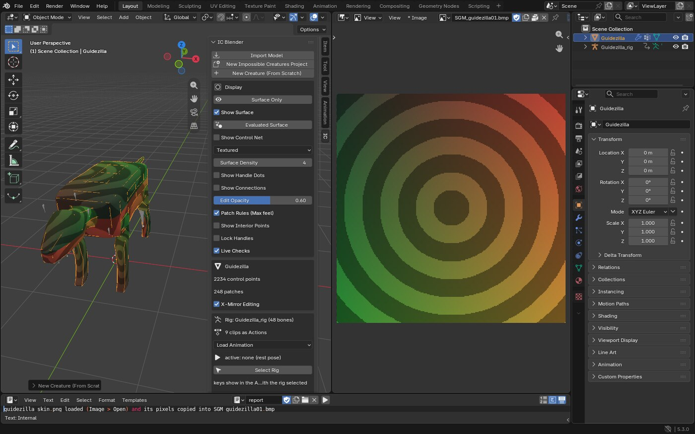

Fig. 99 · The creature shows the copied picture.

## Transfer Texture: a source mesh's own skin

A **fitted** or **retargeted** creature wears the template's skin. **Transfer Texture** gives it the source mesh's skin, with no unwrapping. The source needs a UV layer and an image texture.

1. Keep the textured source mesh in the file.
2. Select the creature and press **Transfer Texture**. It uses the mesh that Fit or Retarget recorded. To use another, change **Source Mesh** in the redo panel.
3. It bakes the source onto one new texture, with a separate square for each patch.
4. All materials now use that texture. Export writes it.

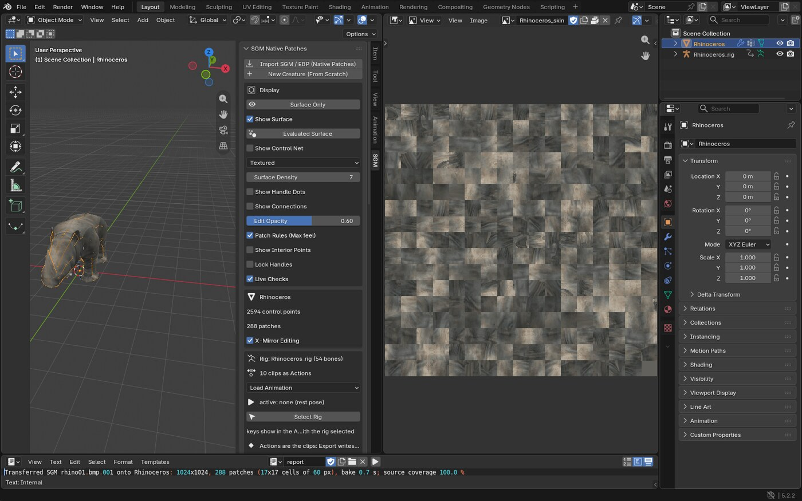

Fig. 100 · Each square of the new texture is one patch.

- With no recorded mesh (a creature that was not fitted or retargeted, such as a new one) it stops with *Choose a source mesh*, and no redo panel appears to choose one. Run it from Blender's Python Console instead, with the creature selected: `bpy.ops.bz.transfer_texture(source="MyMesh")`, where `MyMesh` is the name of the textured mesh.
- Low *source coverage* means parts of the creature found no source and took nearby colours. Raise **Ray Distance**.
- **Size** is 256, 512, 1024 (default) or 2048.
- The most patches a creature can load with drops from about 760 to about 490, and the combine budget by about a third. Check with **Validate**.
- Reflection and specular textures are dropped, with a warning.
- It refuses during a sculpt. A patch creature can't be the source: use its **Bake Textured Mesh** result.

## Refusals and gotchas

- **Missing image.** Don't delete `SGM_…` images: Export refuses. Undo or re-import.
- **Old UV cage.** After Extrude Patch, press **Edit UVs** to rebuild it.
- **Modifiers and transforms.** Extra modifiers, shape keys or an object transform block Export. Apply or remove modifiers; clear transforms with <kbd>Alt</kbd>+<kbd>G</kbd> / <kbd>R</kbd> / <kbd>S</kbd>.
- **Wrong object.** With the baked mesh or UV cage active there's no Export button.
- **Soft brushes.** Only exact magenta is transparent; soft edges leave near-magenta fringes that show.
- **Hidden creatures still draw.** Exclude their collection, or delete them.
- **Saving the .blend.** Don't unpack or purge the skin images.

---

[Contents](README.md) · Previous: [Skinning and re-skinning](skin.md) · Next: [Bones, limbs and connections (Boner)](boner.md)
