[Contents](README.md) · Previous: [Editing an existing animal](edit.md) · Next: [Sculpting: brushes instead of control points](sculpt.md)

# Topology: making geometry, not just moving it

These tools add, remove and join patches. They are in the **Modeling**, **Topology** (Edit Mode) and **Tools** boxes. The examples use `cheetah.sgm`.

**The rule:** two patches are joined only when they share all four control points of a side. A side used by one patch is open, and the game will not load it. Corners in the same place must still be welded.

## Patches are selectable

1. Press <kbd>Tab</kbd>, then <kbd>3</kbd>.
2. Click a patch. Box, lasso, circle, **Select Linked** and **Grow** / **Shrink** work too. <kbd>Alt+Z</kbd> selects through the body.
3. <kbd>H</kbd> hides patches, <kbd>Shift+H</kbd> hides the unselected, <kbd>Alt+H</kbd> unhides.

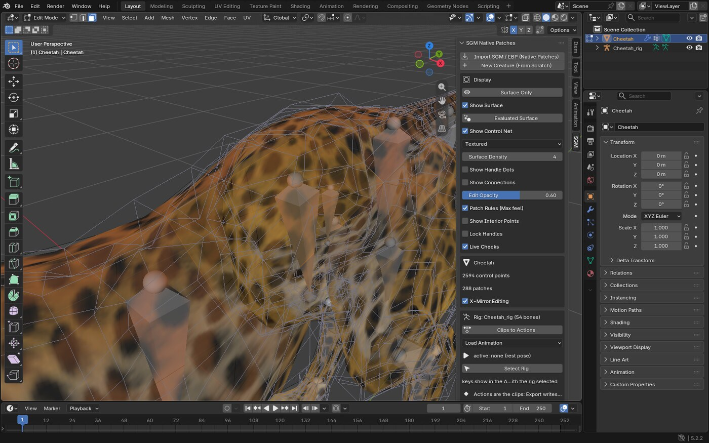

Fig. 30 · A selected patch.

## Delete Patch and Fill Hole

1. Select the patches.
2. Use **Modeling > Delete Patch** or <kbd>X</kbd> > *Patches*. A patch on a connection ring is refused.
3. Close the hole, or Validate blocks it.
4. Use **Topology > Fill Hole**. With several holes, select a corner of one first. A hole needs an even number of sides, at least four.

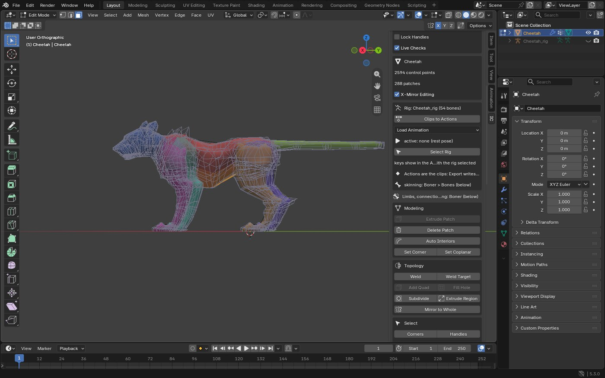

Fig. 31 · Patches selected on both flanks.

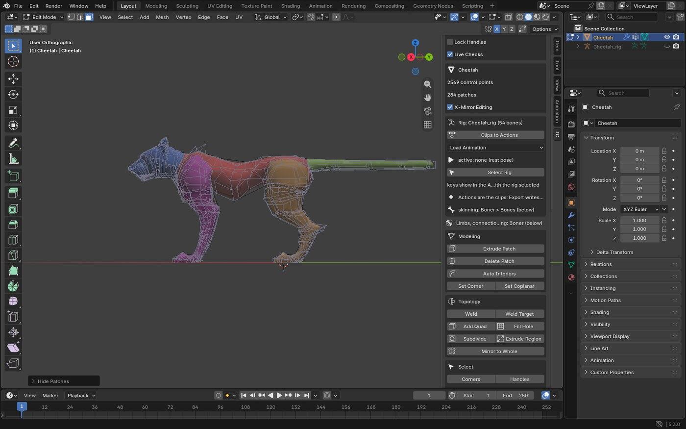

Fig. 32 · After **Delete Patch**, with the far half hidden.

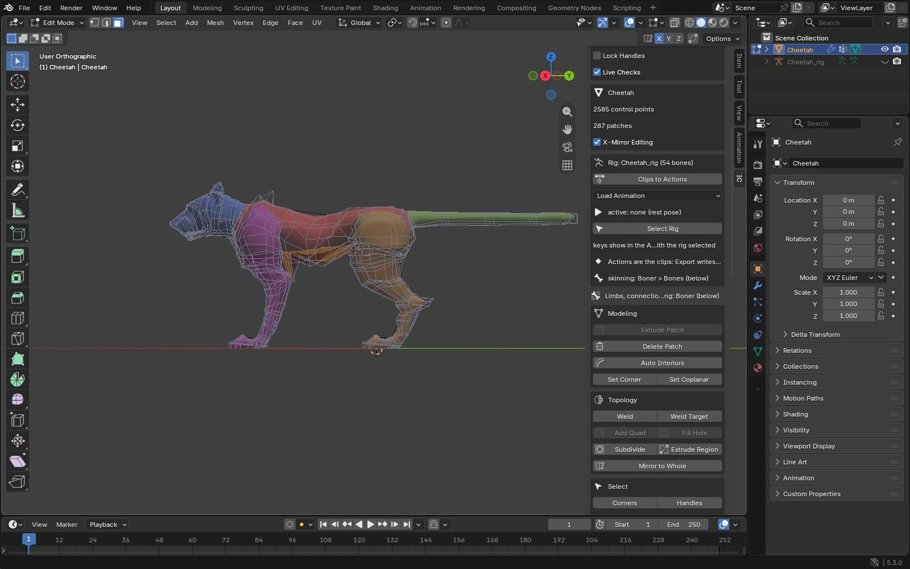

Fig. 33 · **Fill Hole** closes it with no welding needed.

## Add Quad and Weld

**Add Quad** grows a patch on each selected open side, several at once; **Extrude Patch** (see [Editing an existing animal](edit.md)) grows one. To close a gap, move the new corners into place and **Weld**.

1. Select an open side and press **Topology > Add Quad**.
2. Move the two free corners onto the far corners of the hole.
3. Select all four and press **Weld**. **Threshold** 0 means 1 % of the creature's size. **Weld Target** merges into the active corner instead.
4. Welding two open sides also merges their handles, which closes the seam.

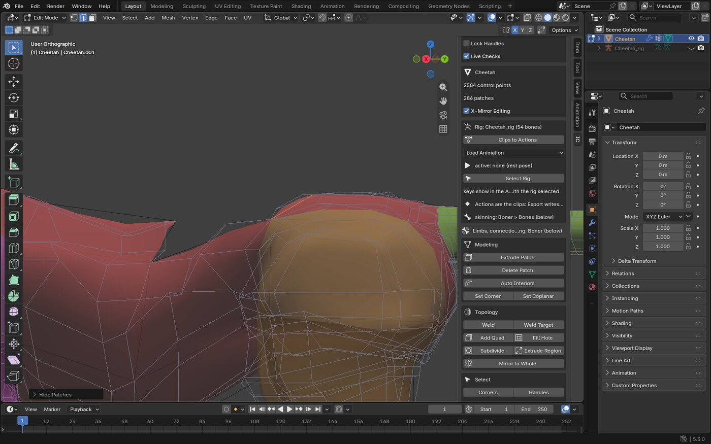

Fig. 34 · An open side selected.

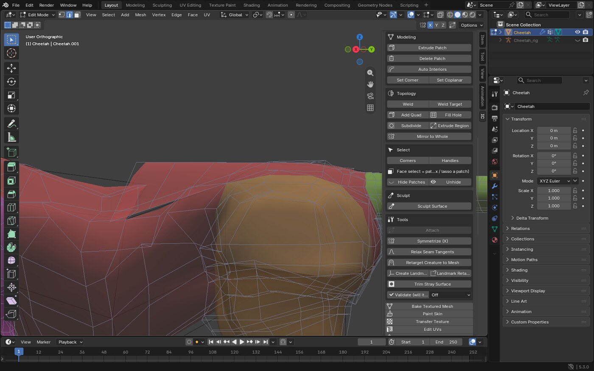

Fig. 35 · **Add Quad** grows a patch.

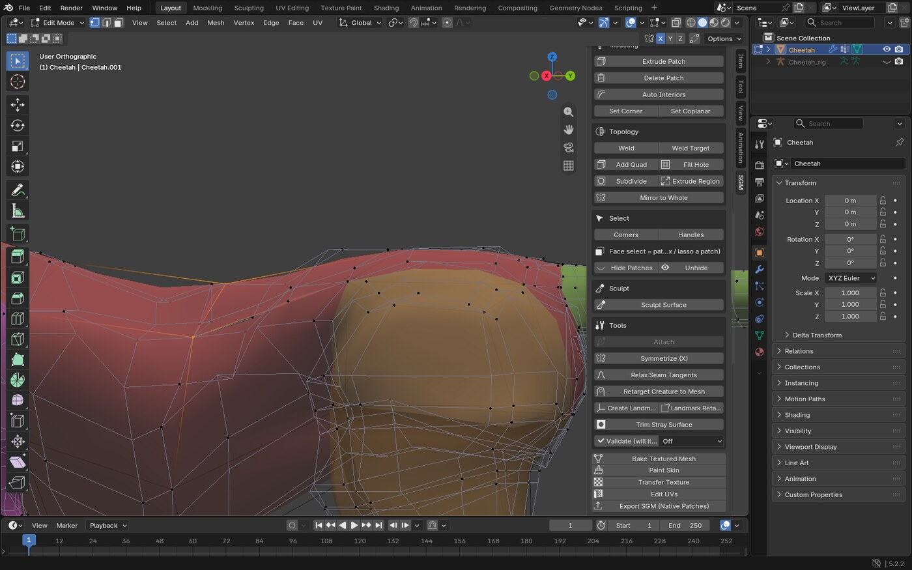

Fig. 36 · The corners moved into place, not yet joined.

Fig. 37 · **Weld** closes the seam.

## Subdivide: more patches where you need them

**Subdivide** splits each selected patch into four without changing the shape. The split carries on through neighbouring patches so no gaps form.

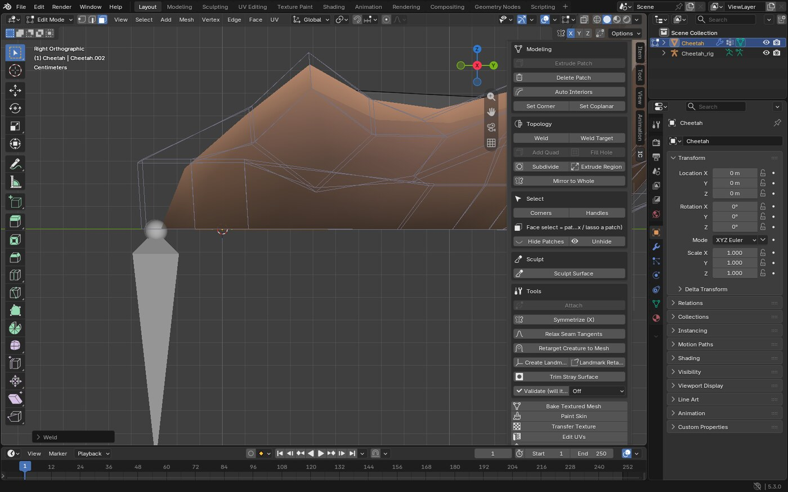

Fig. 38 · One rear-leg patch selected.

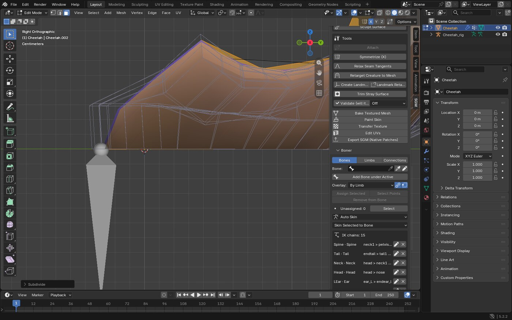

Fig. 39 · The split spreads to its neighbours.

## Extrude Region

**Extrude Region** builds walls around the selected patches so they can be lifted. **Amount** (height) starts at 0, so at first the walls are flat: set it in the redo panel, with **Outline** (scale of the top), or press <kbd>G</kbd> right after to move the new top. To drag at once, search for **Extrude Region (Drag)** (needs Developer Extras).

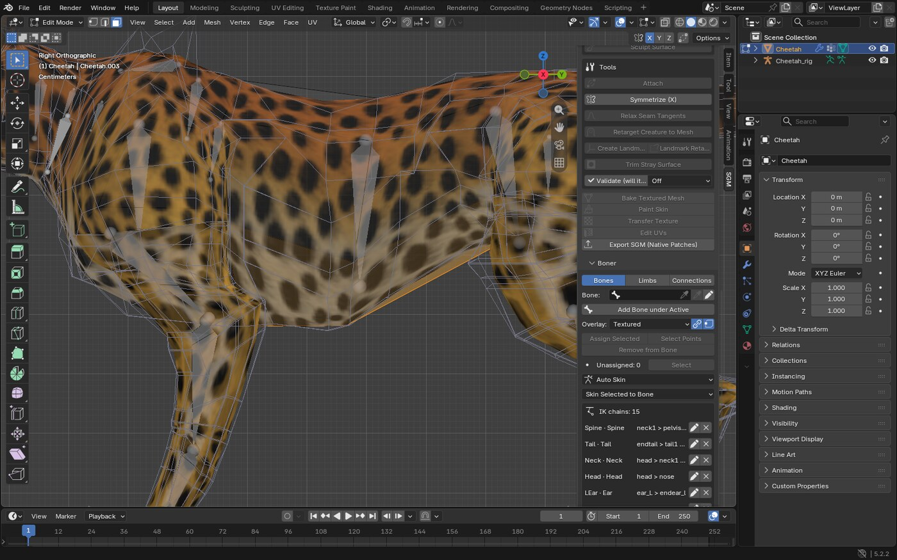

Fig. 40 · Two patches selected.

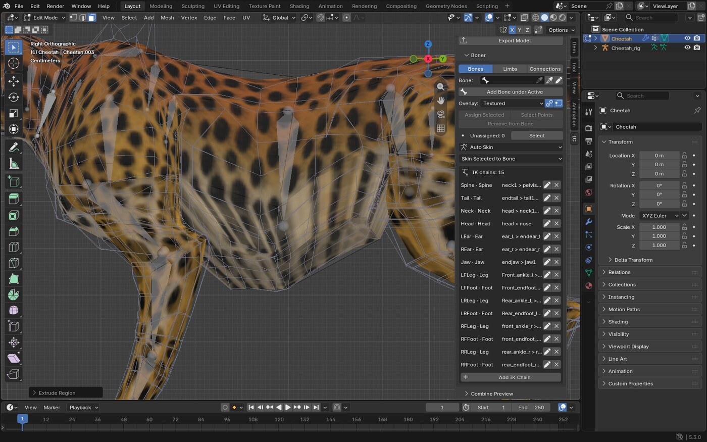

Fig. 41 · The extruded, tapered region.

## Mirror to Whole

**Mirror to Whole** builds the other half from one half. It mirrors the selected patches (or all) across X = 0, joins the centre seam, and uses the matching left or right bones and limbs. **Snap Seam to Plane** (on by default) puts seam points on X = 0.

1. Delete the connections whose rings reach into the unwanted half, then delete that half's patches.
2. Deselect everything and press **Topology > Mirror to Whole**.
3. Mirror to Whole does not rebuild connection rings. Make each deleted connection again in **Boner > Connections** (**Create for Limb**, then **Pick Ring**), then run **Validate**: the game's combiner refuses a creature that lacks a socket.

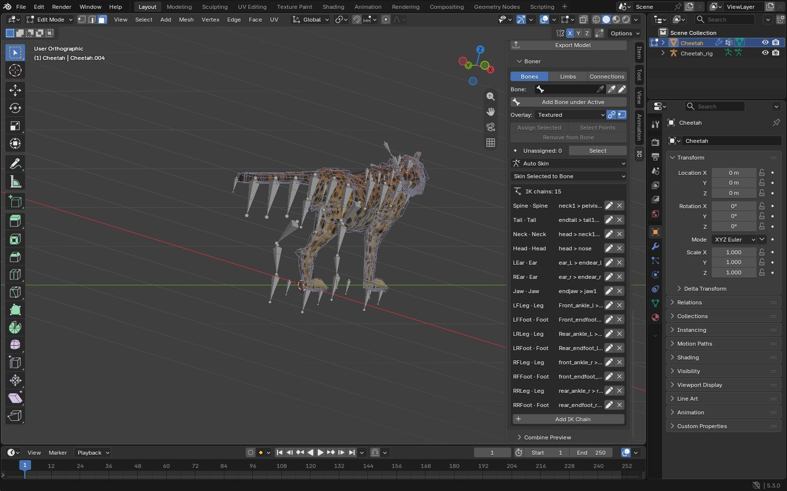

Fig. 42 · Half a creature.

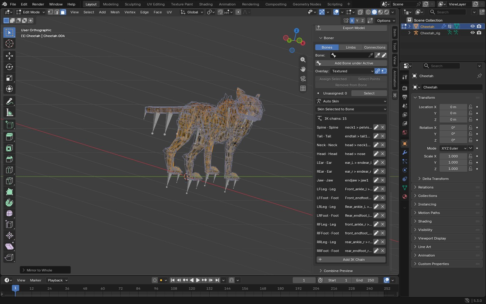

Fig. 43 · **Mirror to Whole** rebuilds the other half.

## Attach: two creatures into one

In Object Mode, select the other creature, make yours active and press **Tools > Attach**. Choose the **Limb** and **Bone** for the new parts.

Every attached patch goes into that one limb, and every attached point is skinned to that one bone: the other creature's skin and limbs are dropped, along with its rig and connection rings. Materials are matched by name. Weld the seams afterwards, then re-skin the new points in **Boner > Bones** and move patches to their limbs with **Assign Selected to Limb**.

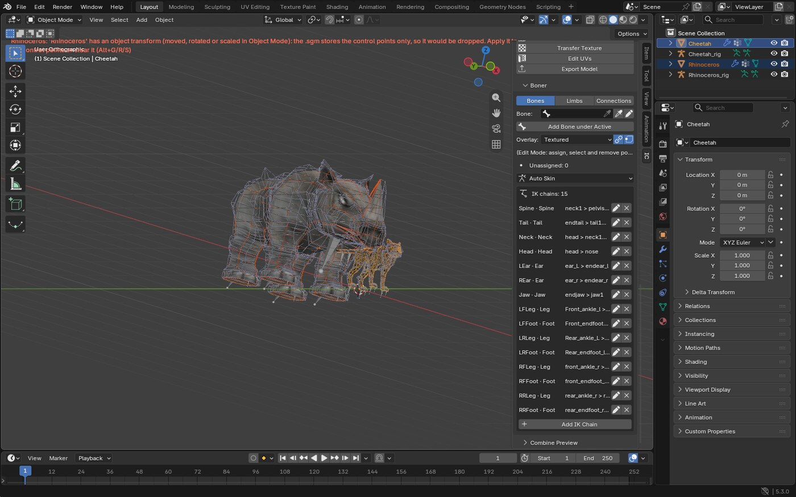

Fig. 44 · Two creatures selected, the cheetah active.

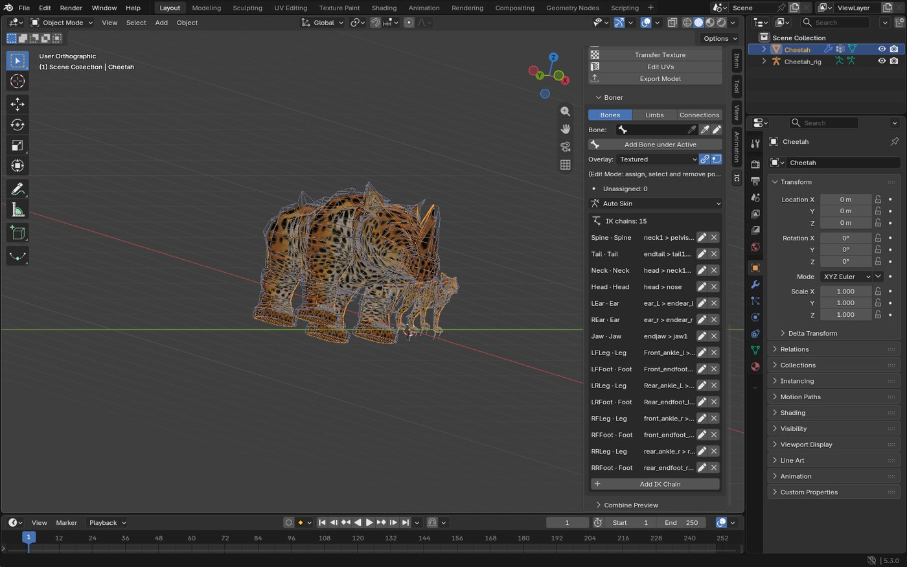

Fig. 45 · The result is one object.

## What it costs: the display-vertex ceiling

The game limits a patch mesh to **12,288 display vertices**. A patch costs about **16** where its seams weld and **25** where it has its own texture island.

- Combining adds the other creature's limbs to the same mesh. To stay safe, use at most **6,584** for the torso and **7,879** for the limbs.
- **Validate** reports your real count; patch count alone does not tell you.
- Attach refuses to exceed 767 patches.

---

[Contents](README.md) · Previous: [Editing an existing animal](edit.md) · Next: [Sculpting: brushes instead of control points](sculpt.md)
