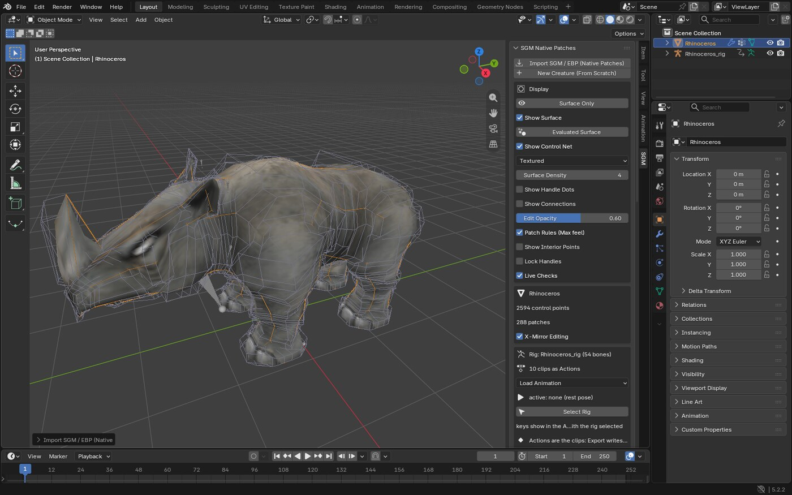
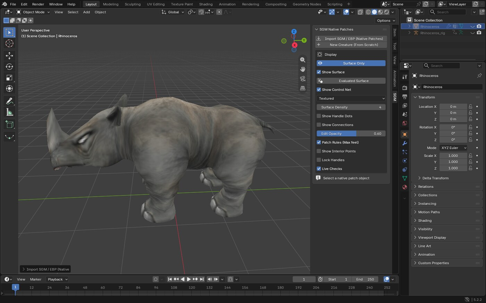
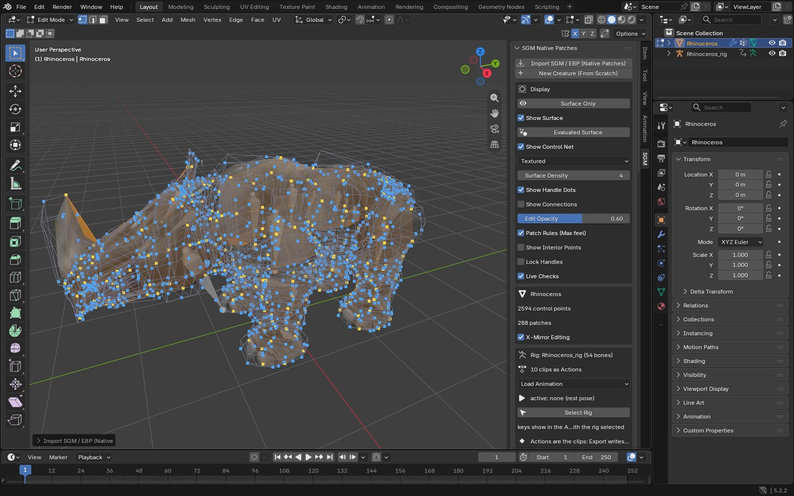
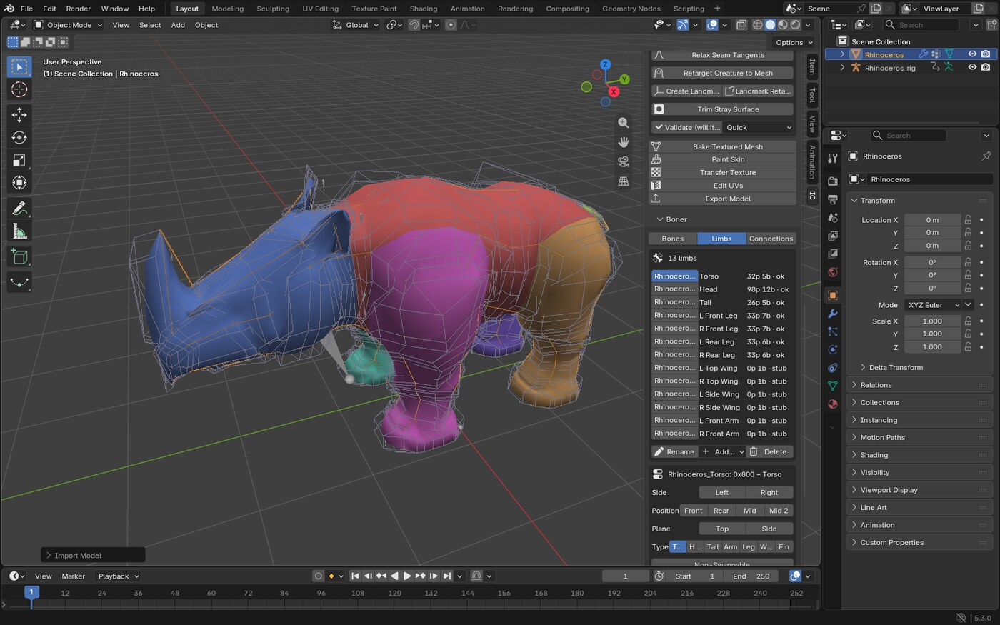
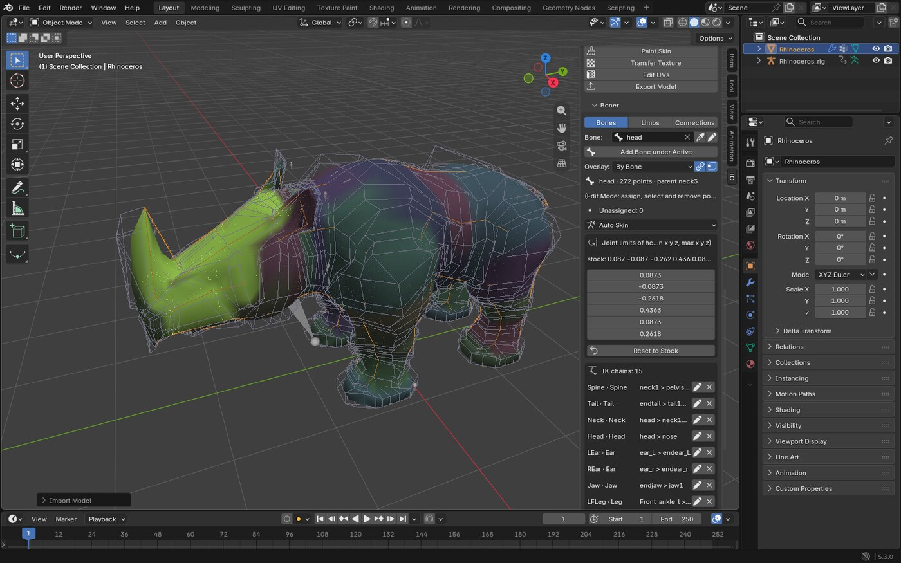
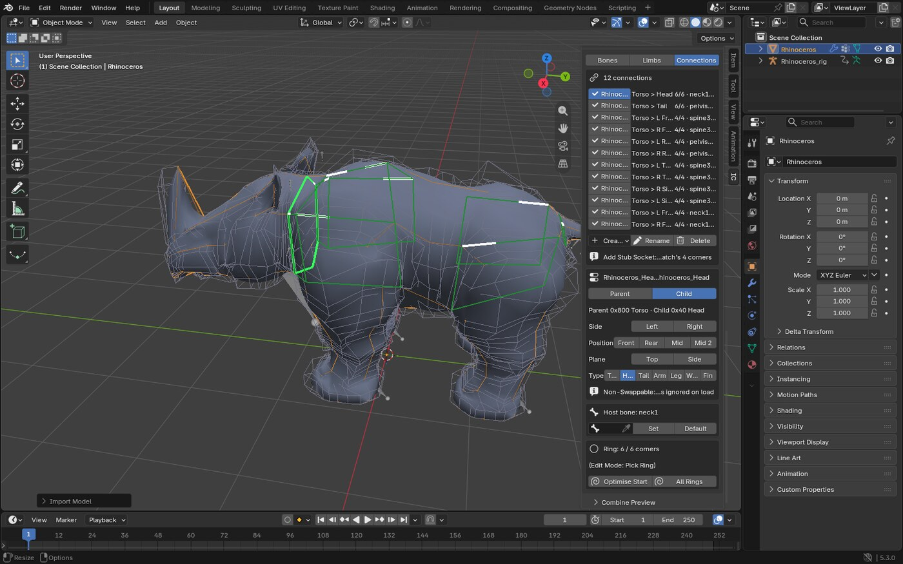
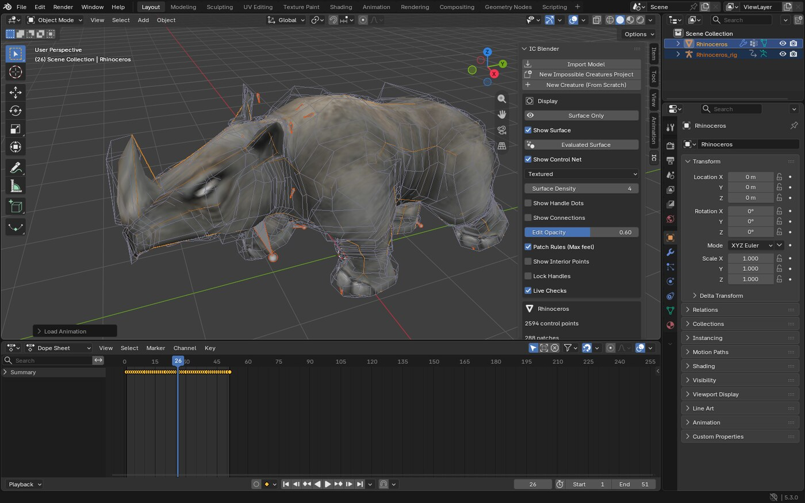
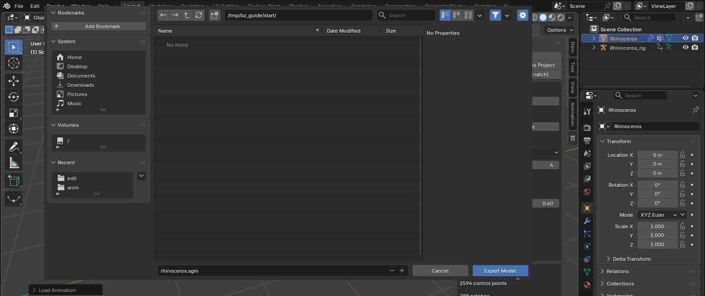
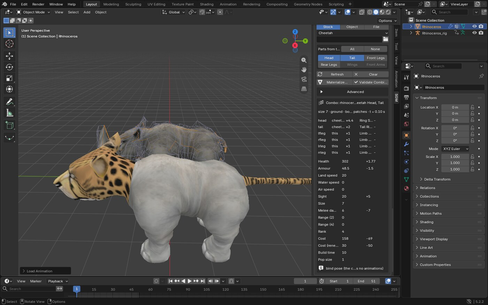
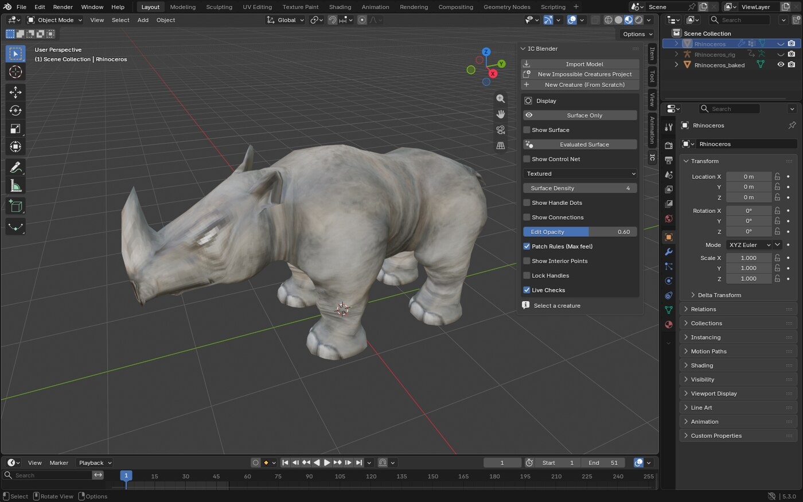

[Contents](README.md) · Previous: [Troubleshooting](trouble.md) · Next: [Editing an existing animal](edit.md)

# Finding your way around a creature

A creature is not made of triangles. It is made of **patches**: small curved surfaces, each held in shape by sixteen points. The points you move in Blender are the **control points** of those patches. The surface you see is drawn from them. This chapter shows what is on screen when a creature is open, using the game's rhinoceros. Use it as a map. The other chapters send you here.

## Where your work is kept, and Relink Source

Files the add-on makes for you (a converted mesh, a fitted creature) go next to your saved `.blend`, or, while the file is unsaved, into Blender's user data folder under `pyic/projects` with a name nothing else holds.

A creature remembers the `.sgm` it was built on. If that file moves, is renamed or is changed, the **Problems** box says so and offers **Relink Source**: pick the file. The same file is accepted at once. A different file with the same number of control points and patches is accepted after a warning (the export will build on *its* skeleton, materials and clips). A file with another body is refused.

## Opening a creature

The easiest way to open one of the game's animals is **File > New > Impossible Creatures Project...** (see [A new creature from a game animal](newcreature.md)). It copies the animal into your folder and opens the copy.

To open any model file you already have, use **IC Model** tab > **Import Model**, or **File > Import > Impossible Creatures Model (.sgm / .ebp)**. Leave **Clips as Actions** on to get each animation as a Blender Action. You can pick the blueprint (`.ebp`) instead of the model. Only the model is imported.

Two objects appear: the creature (its control points) and its rig (the skeleton). Frame the creature with **View > Frame Selected** (numpad <kbd>.</kbd>).

Fig. 6 · Control points, control net and textured surface after import.

Gatherers, characters, structures and props use the same button and open as ordinary meshes; see [Structures and props](structures.md) and [Gatherers and characters](gatherers.md).

The 3D view shows a model the way the game draws it, not as a mirror image. A creature faces Blender's −Y, and its `_l` bones sit on the −X side, as they show in the game. Writing on a texture reads the same in Blender and in the game.

A `.blend` file saved with an add-on older than 0.9.2 holds its models flipped left to right. Every tool refuses such a model with the message *“This was made with an older version of IC Blender. Import the original file again.”* To fix it, open the model again with **File > Import** (or start the project again).

## What you are looking at

- **Control points:** each vertex is one. A shared corner is a single vertex, so the surface stays closed.
- **Surface:** a live textured overlay that follows your edits and the posed rig.
- **Control net:** the 4x4 grid of every patch.
- **Rig:** a Blender armature. Each control point belongs to one bone.
- **Clips:** Actions on the rig. Edit, rename, add or delete them, and Export writes them. A new clip is written only while it is the rig's active Action or sits on one of its NLA tracks (see [Animations](anim.md)).

The **Display** box:

- **Surface Only** hides the control points and rig. Turn it off to edit.
- **Show Surface**, **Show Control Net**: toggle the overlays.
- **Evaluated Surface**: real geometry that renders in Eevee and Cycles. Editing is slower with it on.
- Shading menu: **Textured**, **By Limb**, **By Bone** or **Plain**.
- **Surface Density**: smoothness of the drawn surface.
- **Show Handle Dots**: corners gold, handles blue.
- **Show Connections**: highlights the rings where limbs attach.
- **Edit Opacity**: surface opacity in Edit Mode.
- **Patch Rules (Max feel)**: a corner drags its handles, and interior points move automatically. Off means raw point editing.
- **Show Interior Points**: unhides those points.
- **Lock Handles**: a corner's other handles rotate with the one you move.
- **Live Checks**: shows warnings while you work.

Fig. 7 · **Surface Only** shows just the surface.

1. Press <kbd>Tab</kbd> for Edit Mode. The panel adds the **Modeling**, **Topology** and **Select** boxes. A greyed-out button says why in its tooltip.
2. Select a point and press <kbd>G</kbd>. Box and lasso select, proportional editing (<kbd>O</kbd>) and snapping work. **X-Mirror Editing** is on after import.
3. Press <kbd>3</kbd> to select whole patches.

Fig. 8 · Edit Mode with **Show Handle Dots**.

## The IC Model tab, top to bottom

At the top of the **IC Blender** panel are four buttons: **Import Model**, **New Impossible Creatures Project**, **New Creature (From Scratch)** and **Extract Stock Creatures**. Below them is the **Display** box. Below that, a creature shows:

- Name, control-point and patch counts, and **X-Mirror Editing**.
- The rig box: **Load Animation**, the active Action and **Select Rig**.
- **Sculpt**: see [Sculpting](sculpt.md).
- **Tools**: **Attach**, **Symmetrize (X)**, **Relax Seam Tangents**, **Retarget Creature to Mesh**, **Create Landmarks**, **Landmark Retarget**, **Trim Stray Surface**, **Validate (will it load?)** and **Combine Checks**.
- **Bake Textured Mesh**, **Paint Skin** and **Transfer Texture** (when the creature has textures), **Edit UVs**, **Apply UVs** (while a UV cage exists) and **Export Model**.
- In Edit Mode the **Modeling**, **Topology** and **Select** boxes, and the **Hard Edges and Materials** box ([Editing an existing animal](edit.md)).
- The **Boner** and **Combine Preview** sub-panels.
- The line **For the game: IC Game tab**. Everything that takes the creature into the game is in the **Game** panel of the **IC Game** tab ([Check, export, install, remove and share](ship.md)).

With an ordinary mesh active, **Fit Patches to Mesh** appears above **Display** (see [Fitting a mesh](fit.md)).

## Boner: Bones, Limbs, Connections

**Boner** has three tabs: Limbs, Bones and Connections. With **Follow Shading** on (the link icon on the Bones tab), the Limbs and Bones tabs switch the shading to match.

1. **Limbs** lists each limb's class, counts and status. A `stub` limb has no patches but lets other creatures' parts attach. Click a limb to classify, **Rename** or **Delete** it. In Edit Mode use **Select Limb** and **Assign Selected to Limb**.

Fig. 9 · **By Limb** shading with the Limbs tab.

2. **Bones**: choose a **Bone** (or **Pick Bone**), rename it, or **Add Bone under Active**. In Edit Mode use **Assign Selected**, **Select Points** and **Remove from Bone**. **Auto Skin** gives points their nearest bone. Export refuses patch points with no bone. Joint limits are below. Delete or re-parent bones in the rig's Edit Mode.

Fig. 10 · The `head` bone's points are highlighted.

3. **Connections** lists the rings where limbs attach. Use **Create for Limb**, **Rename**, **Delete** and, in Edit Mode, **Add Stub Socket**. For the active ring set the Parent and Child classes, host bone (**Set** / **Default**) and corners (**Pick Ring** / **From Selection**). **Optimise Start** and **All Rings** pick the best starting corner for combining.

Fig. 11 · **Show Connections** draws the rings on the creature.

## Playing a clip

1. Choose **Load Animation > walk**.
2. Press <kbd>Space</kbd> or scrub the timeline.
3. To edit keys, press **Select Rig** and open a Dope Sheet or Action Editor.

Fig. 12 · The walk clip with its keys in a Dope Sheet.

## Validate: four kinds of line

**Validate (will it load?)** checks the creature as Export would write it. The button **Check the Creature** in the **Game** panel does the same and then also checks what **Export Creature for the Game** would refuse (the numbers, the motions, the events). If you only press one, press that one.

- **Blocking problems** (red) stop the game loading it. `EXPORT BLOCKED` means Export would refuse; the message says why. If you deleted, merged or duplicated vertices, press <kbd>Ctrl</kbd>+<kbd>Z</kbd>.
- **STOCK**: something every base-game creature has is missing. It still loads.
- **WARN**: advice about export, limbs or connections.
- **COMBINE**: combining problems, never blocking. **Combine Checks: Quick** runs test combines; **Off** only the instant check.

1. Leave **Combine Checks** on **Quick** and press **Validate (will it load?)**.
2. Read the verdict in the status bar and every line in the **Info** editor.

## Export Model

**Export Model** writes only the model file (`.sgm`). The game cannot use that file by itself. To play a creature in the game, use **Export Creature for the Game** instead. Use **Export Model** to save a model to open again later, or to hand to another tool.

1. Press **Export Model**, or use **File > Export > Impossible Creatures Creature (.sgm)**. Save somewhere of your own and keep the stock files.

Fig. 13 · Choose the `.sgm` to write.

2. Read the report. It lists what changed.

Export checks the model first, and its message says how to fix anything it refuses.

## Combine Preview

In the game, the creature creator joins two animals into one. **Combine Preview** shows what your creature would look like joined with another animal, with your unsaved edits in it. It needs the game's animals as files:

1. Press **Extract Stock Creatures** (the top of the **IC Model** tab) once. It copies the game's base animals into Blender's user data folder, under `pyic/engine_stock`. The message at the bottom of the window shows the folder. Nothing in your game folder is changed.
2. Open the **Combine Preview** sub-panel.

1. Choose **This Creature Is the Torso** or **This Creature Donates Parts**.
2. Choose the other creature: **Stock**, **Object** (in this scene) or **File**.
3. Toggle the parts: **Head**, **Tail**, **Front Legs**, **Rear Legs**, **Wings**, **Front Arms**, **Mid Legs** and **Second Mid Legs** (the middle legs of insects and spiders; see the note below).
4. Press **Preview**. A ghost appears with its stats and warnings; press **Refresh** after edits. **Clear** removes it, **Materialize…** saves it as a creature and imports it, and **Validate Combines** runs the quick checks.

Fig. 14 · A rhinoceros torso with a cheetah head and tail.

> [!NOTE]
> The game takes a limb that is marked non-swappable only from the animal it belongs to. The middle legs of every insect and spider of the base game are marked so. For those animals the **Mid Legs** buttons change nothing, and the panel says why. They work for a creature of your own whose middle legs are not marked. There are no buttons for fins, stubs and antennae, because the game's combiner has no slot for them.

## Bake Textured Mesh

To render in Eevee or Cycles, press **Bake Textured Mesh**. It makes a textured copy, `Rhinoceros_baked`. **Posed** (redo panel) bakes the current pose. Editing the copy does not change the creature.

Fig. 15 · The baked copy in Material Preview.

Keep the creature at the origin without transforms, modifiers or shape keys, and keep the source `.sgm` where it was: export reads it again.

---

[Contents](README.md) · Previous: [Troubleshooting](trouble.md) · Next: [Editing an existing animal](edit.md)
